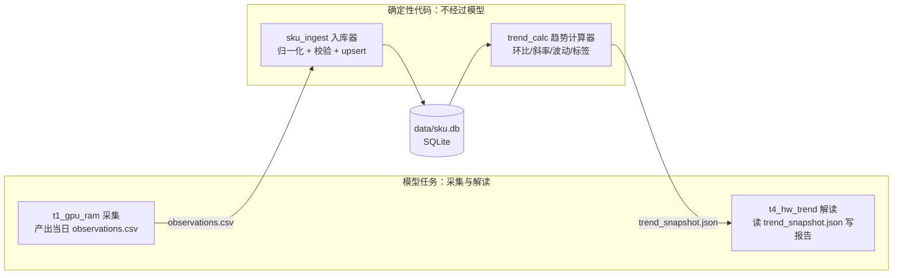
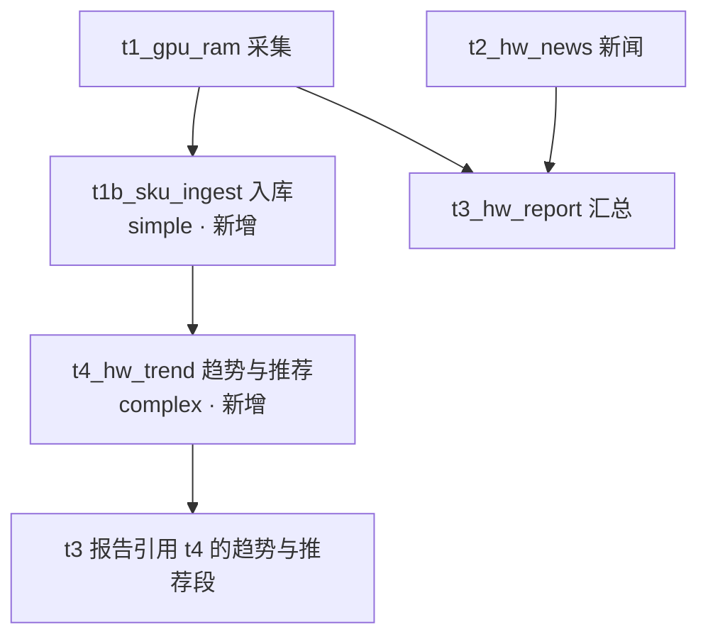

# 设计文档：SKU 级时序观测库与趋势分析（sku.db）

> **存档版本 v1**（2026-10-10 初版）· 本文件是历史存档，不再更新。
> 当前评审稿见 `sku-timeseries-db-v3.1.md`；版本总索引见 `sku-timeseries-db.md`。

---

> 状态：**待评审** · 起草 2026-10-10 · 适用范围：orchestrator 全部调研链
> 评审方式：文末「开放问题清单」共 8 项需拍板，其余为实现细节可后续调整。

---

## 1. 背景与目标

用户需求（2026-10-10 原话归纳）：

1. **SKU 级逐日记录**：如 RTX 5060 Ti 8G 每日低价入库（含店铺信息、优惠券情况），
   逐日累积观察变化趋势；
2. **价格趋势分析**：哪些 SKU 在快速下降、哪些在快速拉高、哪些趋平稳可以入手；
3. **综合推荐建议**：最近哪款涨得高、哪款性价比高、装机推荐哪款；
4. **跨域范式**：不止显卡——楼市某楼盘某户型的价格变化同样入库，
   随时间绘制趋势，判断「哪一个可以入手、房价是否企稳」。

一句话：**给每日调研任务补一条纵向时间轴**。当前系统只有「当日横截面」
（每日一份 CSV/MD/JSON 文件），没有跨日可比的结构化累积。

## 2. 现状诊断（为什么不能直接「把 CSV 存进库」）

拿 hardware_daily 的 t1_gpu_ram.csv 实测（2026-10-08 ~ 10-10 三天）：

| 日期 | 同一颗 RTX 5090 的「型号」写法 | 价格日期口径 |
|---|---|---|
| 10-08 | `GeForce RTX 5090(美行新卡最…)` | 2026-10-06 |
| 10-09 | `RTX 5090(国行整机参考)` | 2026-10-01 |
| 10-10 | `RTX 5090 (京东5090D 全新)` | 2026-10-03 |

三个致命问题：

- **SKU 命名漂移**：渠道/成色/整机的后缀每天随机挂在型号里，
  同一 SKU 三天三个字符串，跨日 join 不可能成立；
- **口径混杂**：单卡国行、整机参考、美行折算混在同一行里，
  价格差出 2 倍（34999 vs 84899），纵向对比无意义；
- **环比是模型口算的**：`上期价格` 列大量「未查到」，涨跌幅随机缺失。

结论：**入库前必须先解决「序列身份」问题**——SKU 归一化 + 口径分轨。
否则时序库是垃圾进垃圾出，趋势图是噪声图。

另一个现状约束：executor 渲卡/产物全部走文件（artifacts/），
模型没有也不应有直接写 DB 的能力（现有工具白名单：python/pytest/ruff/node，
文件写在 artifacts 下）。**写库与算趋势都应是确定性代码，模型只产数据与解读**。

## 3. 设计总览



分工铁律（与现有「验收防模型编数」的哲学一致）：

- **模型**：检索、抄录数字进结构化 CSV、解读趋势、写推荐叙事；
- **确定性代码**：SKU 归一化、入库、趋势指标计算。模型永远不直接
  读写 DB——trend_snapshot.json 里的每个数字都可由 python_test 规则
  对 DB 重算复核。

## 4. 核心设计决策

### D1 数据库选型与位置：SQLite，`data/sku.db`

- 单机单写者（入库器），量级小（百 SKU × 千日 = 十万行级），
  SQLite 绰绰有余，零部署；
- 与 `state/state.db`（任务状态机）**物理分离**——业务观测数据
  不与调度状态混库，损坏域隔离、备份策略独立；
- 预留 WAL 模式（读并发：趋势计算与人工查询可同时进行）。

### D2 序列身份：SKU 注册表 + 口径分轨

**序列（可画趋势线的最小单位）= (domain, canonical_name, channel)**。

- `canonical_name`：规范名，如 `NVIDIA RTX 5060 Ti 8GB`、
  `南京·仁恒江湾城·89㎡三房`；
- `channel`：口径轨。硬件域枚举 `国行单卡/整机参考/美行折算/二手`；
  楼市域枚举 `新房/二手挂牌/二手成交`。同一 SKU 不同口径是**平行序列**，
  各自独立趋势，永不混线（解决 §2 的 5090 悲剧）；
- `aliases`：别名表。`5060Ti`、`5060 TI`、`GeForce RTX 5060 Ti`
  都归到同一 canonical。

**归一化是确定性规则，不是模型判断**（入库器内实现）：

1. 剥离渠道/成色括号后缀（`(京东全新)`、`(丐版国内)`…）；
2. 全半角/空格/大小写/ti→Ti/显存 `8G→8GB` 等规则归一；
3. 查别名表；
4. **仍未命中的行进隔离区**（`observation_quarantine` 表），
   不进主序列——宁缺毋滥，隔离区每天在日报里报数，人工定期
   把高频新 SKU 收编进注册表。

### D3 模型只产 CSV，入库是确定性管道

t1 采集任务的新增副产物（与现有 CSV 并行，见 §6 模板 delta）：

`artifacts/{date}/t1_sku_observations.json`（结构固定，任务卡内联 JSON 形状）：

```json
[{
  "raw_name": "RTX 5060 Ti 8G(七彩虹战斧)",
  "canonical_hint": "NVIDIA RTX 5060 Ti 8GB",
  "channel": "国行单卡",
  "low_price": 2899.0,
  "raw_price": 3199.0,
  "price_date": "2026-10-10",
  "shop": {"name": "七彩虹京东自营旗舰店", "platform": "京东", "url": "…"},
  "coupons": [{"name": "满3000减200", "amount": 200, "threshold": 3000, "expire": "2026-10-15"}],
  "in_stock": true,
  "source_url": "…", "source_tier": "B"
}]
```

- `canonical_hint` 是模型给的归一化提示，**入库器最终裁决**
  （提示对不上注册表也进隔离区）；
- 入库器做行级校验（价格数值域、日期不晚于采集日、店铺字段齐全），
  坏行进隔离区并计数告警。

### D4 趋势指标：确定性计算，输出 trend_snapshot.json

对每个 active 序列计算（窗口按观测期数，硬件=自然日、楼市=期）：

| 指标 | 定义 |
|---|---|
| `d1_pct` | 最新观测对前一观测的环比 % |
| `avg_7d` / `slope_7d` | 近 7 期均价；对 (期, 价) 最小二乘斜率（%/期） |
| `vol_7d` | 近 7 期价格标准差 / 均值（波动率） |
| `min_30d` / `pct_from_low` | 近 30 期最低价；现价距低点 % |
| `label` | `fast_drop`(斜率≤-1%/期) / `drop` / `stable`(\|斜率\|<0.2% 且 vol<2%) / `rise` / `fast_rise`(≥+1%/期) / `near_low`(距低点≤3%) |
| `sufficiency` | 覆盖期数 <5 标 `insufficient_data`，报告不得对该 SKU 下趋势结论 |

快照文件 `artifacts/{date}/trend_snapshot.json` 附 mermaid 数据段
（每 SKU 一条可直接渲染的 xychart 行），t4 解读任务**逐字引用**。

### D5 入库触发方式（三案对比，推荐 B）

| 方案 | 做法 | 优点 | 缺点 |
|---|---|---|---|
| A. run_daily 后处理 hook | t1 DONE 后由 run_daily 调入库脚本 | 无新任务 | run_daily 是通用驱动器，塞业务专用逻辑污染它 |
| **B. 独立 simple 任务（推荐）** | 新任务 `t1b_sku_ingest`，complexity=simple、needs_web=false，卡上写明「执行 python -m tools.sku_ingest --date {date}」 | 有状态/重试/验收（python_test 查库行数），与现有 DAG 一致 | 模型可能不执行脚本——用验收兜底：当日 DB 新增行数≥10 否则 FAIL |
| C. verifier 通过后自动触发 | 验收管线内嵌 | 强绑定 | 验收语义被污染，回填/重跑语义混乱 |

### D6 幂等与重跑

- 入库唯一键 `(sku_id, price_date, shop_platform, shop_name)`，
  重跑 upsert（ON CONFLICT DO UPDATE）——同日重跑不产生重复序列点；
- 趋势快照纯函数式重算，天然幂等；
- 回填：`python -m tools.sku_ingest --date 2026-09-29 … 2026-10-10`
  复用同一命令（历史 CSV 需先补 observations.json——见 §10）。

## 5. 数据模型（DDL）

```sql
-- 序列注册表：一行 = 一条可画趋势线的序列
CREATE TABLE sku (
  sku_id        INTEGER PRIMARY KEY,
  domain        TEXT NOT NULL,           -- hardware / housing
  category      TEXT NOT NULL,           -- gpu / cpu / mb / ram / 小区 / 楼盘户型
  canonical_name TEXT NOT NULL,          -- NVIDIA RTX 5060 Ti 8GB
  channel       TEXT NOT NULL DEFAULT 'main',  -- 国行单卡/整机参考/… 新房/二手挂牌/…
  brand         TEXT, model TEXT, spec TEXT,
  aliases       TEXT,                    -- JSON 数组（归一化规则外的手工别名）
  perf_anchor   REAL,                    -- 可选性能锚点分（性价比用，见开放问题 Q6）
  active        INTEGER NOT NULL DEFAULT 1,
  created_at    TEXT, updated_at TEXT,
  UNIQUE(domain, canonical_name, channel)
);

-- 观测表：一行 = 某序列某价格日某店铺的报价
CREATE TABLE observation (
  id          INTEGER PRIMARY KEY,
  sku_id      INTEGER NOT NULL REFERENCES sku(sku_id),
  obs_date    TEXT NOT NULL,             -- 价格日期（来源页面口径，非采集日）
  collected_on TEXT NOT NULL,            -- 采集日（= artifacts/{date}）
  low_price   REAL,                      -- 券后到手价
  raw_price   REAL,                      -- 券前价
  price_unit  TEXT NOT NULL DEFAULT 'CNY',  -- CNY / 元每平米 / 万元每套
  shop_name   TEXT, shop_platform TEXT, shop_url TEXT,
  coupons     TEXT,                      -- JSON 数组（见 §4 D3）
  in_stock    INTEGER,
  source_url  TEXT, source_tier TEXT,
  raw_json    TEXT,                      -- 入库时的整行快照（审计/回放）
  created_at  TEXT,
  UNIQUE(sku_id, obs_date, shop_platform, shop_name)
);
CREATE INDEX idx_obs_sku_date ON observation(sku_id, obs_date);

-- 隔离区：归一化失败/行校验失败的行，主序列的看门人
CREATE TABLE observation_quarantine (
  id INTEGER PRIMARY KEY, collected_on TEXT, reason TEXT,  -- no_canonical / bad_price / bad_date …
  raw_json TEXT, created_at TEXT
);
```

**楼市映射示例**：`domain=housing, category=小区租售比,
canonical_name=南京·仁恒江湾城, channel=二手挂牌,
low_price=单价(元/㎡), price_unit=元每平米`；
户型级跟踪则 `canonical_name=南京·仁恒江湾城·89㎡三房`。

## 6. 任务编排变更（以 hardware_daily 为例）



- **t1_gpu_ram（改）**：objective 增加副产物 `t1_sku_observations.json`
  （字段形状内联进卡，含 canonical_hint/channel/店铺/优惠券），
  「型号列写规范名，渠道成色放 channel 与 shop 字段，不许塞进型号」；
- **t1b_sku_ingest（新，simple）**：执行入库命令，验收 =
  python_test 查当日 collected_on 的新增/更新行数 ≥10 且隔离区增量汇报；
- **t4_hw_trend（新，complex）**：读 trend_snapshot.json，
  产出 `hw_trend.md`（趋势榜 + mermaid 趋势图 ≥3 张：降价榜/涨价榜/
  重点 SKU 单品走势）+ `hw_recommend.json`（推荐结构，见 §7）；
- **t3_hw_report（改）**：inputs 增加趋势产物，「综合推荐」一节
  逐字引用 t4 结论并附图。

**验收门禁新增**（acceptance 层）：
- t4：python_test——从 DB 重算 3 个抽样 SKU 的 `d1_pct/slope_7d`
  与 trend_snapshot.json 一致（防模型改数）；
- t4：business_rule——`hw_recommend.json` 里每个被推荐的 SKU
  必须存在于 trend_snapshot 且非 `insufficient_data`；
- t1：json_schema——observations.json 形状（canonical_hint 必填）。

## 7. 推荐建议的结构（hw_recommend.json）

```json
{
  "date": "2026-10-10",
  "fast_dropping": [{"canonical": "…", "slope_7d": -1.4, "days_to_30d_low": 2}],
  "fast_rising":  [{"canonical": "…", "slope_7d": 1.8}],
  "stable_buy":   [{"canonical": "…", "vol_7d": 0.9, "pct_from_low": 1.2}],
  "best_value":   [{"canonical": "…", "perf_per_yuan": 3.1, "vs_peer": "+18%"}],
  "build_advice": [{"budget": "6000-8000元", "gpu": "…", "reason": "…"}],
  "no_advice":    [{"canonical": "…", "why": "insufficient_data"}]
}
```

推荐**叙事**由模型写（读快照），**入榜资格**由确定性标签决定——
模型只能从标签允许的池子里选，不能给数据不足的 SKU 下结论。

## 8. 数据质量防线

| 风险 | 防线 |
|---|---|
| 模型抄错价格（多零/少零） | 入库器数值域检查（与该序列近 7 期均值偏离 >50% 进隔离区 + P2 告警） |
| 渠道口径伪装成型号 | 归一化剥离 + channel 枚举校验 |
| 同日多店铺多价 | 全部入库（唯一键含店铺），序列取**当日最低 low_price** 为序列点 |
| 券过期导致口径漂移 | coupons 带 expire，趋势计算只看 low_price（券后），快照记 raw 价供参考 |
| 序列断档 | sufficiency 标签；报告禁言 |

## 9. 楼市域接入（P2）

- `housing_rr_fiveday` 的 `t_rr_top20.data.json`（每 5 天三城各 20 小区）
  直接入库：`domain=housing, category=小区租售比`，观测
  `low_price=price_per_sqm, price_unit=元每平米`，另以扩展字段记
  `rr_pct`（租售比也走同一 observation 表：`price_unit=rr_pct` 的第二序列，
  或 sku 表加 `metric` 字段——倾向后者，见开放问题 Q5）；
- 楼盘户型级（用户点名的范式）：在 housing_daily 增设与
  t1b 同构的入库任务，canonical=`城市·楼盘·户型`；
- 趋势窗口按期数（5 天一期），`near_low` 判据改为距 6 期低点。

## 10. 历史回填

- 9-29 ~ 10-10 共 11 天 t1_gpu_ram.csv 可回填，但缺
  observations.json（渠道/店铺/券信息不在旧 CSV 里）——**只回填
  能可靠映射的行**（型号→canonical 成功率预计 60-70%，其余进隔离区），
  用于把 `sufficiency` 从 1 期垫到 5+ 期；
- 回填前先跑 `--dry-run` 输出「旧型号串 → canonical」映射表人工确认。

## 11. 分期实施

| 期 | 内容 | 交付物 |
|---|---|---|
| **P0** | DB schema + 归一化器 + 入库器 + t1 模板改造 + 历史回填 | data/sku.db 开始累积 |
| **P1** | 趋势计算器 + t4 任务 + 验收（python_test 复核）+ 报告改造 | 日报出现趋势榜与图 |
| **P2** | 推荐结构 + 性价比 + 楼市域（rr_top20 入库 + 楼盘户型） | 跨域范式成立 |

## 12. 开放问题清单（需评审拍板）

| # | 问题 | 我的倾向 |
|---|---|---|
| Q1 | channel 枚举由谁维护（入库器硬编码 vs sku.db 字典表） | 字典表（可随 domain 扩展） |
| Q2 | 隔离区收编流程：人工定期 vs 模型辅助提案+人工确认 | 后者（高频新 SKU 收编快） |
| Q3 | 性能锚点（性价比的分母）从哪来：人工表 vs 每型号检索跑分 | 人工维护小表（20-30 个主流 SKU） |
| Q4 | 趋势图粒度：每 SKU 一图 vs 榜单聚合图 + top3 单品图 | 后者（图太多报告不可读） |
| Q5 | 租售比这类非价格指标：同表 `metric` 字段 vs 独立表 | 同表 metric（复用全部管线） |
| Q6 | 观测日口径：页面标注 price_date vs 采集日 collected_on 作序列轴 | **price_date 为序列轴**（collected_on 仅审计），页面无日期时回落采集日并打标 |
| Q7 | 硬件域先收哪些 SKU 进注册表（建议首发 ~30：50/40 系显卡、9000 系、DDR5 主流容量、13600/9800X3D 等） | 我出默认清单，评审时勾改 |
| Q8 | t4 频率：随链每日 vs 独立低频（趋势变化慢，每日=重复劳动） | 随链每日但输出增量段落（只有变化才进报告） |

---

附：本设计不改变现有「模型-验收-确定性代码」的权责边界，
新增的全部确定性组件（入库器/计算器）放 `orchestrator/tools/`，
与 `core/`（调度域）解耦。
