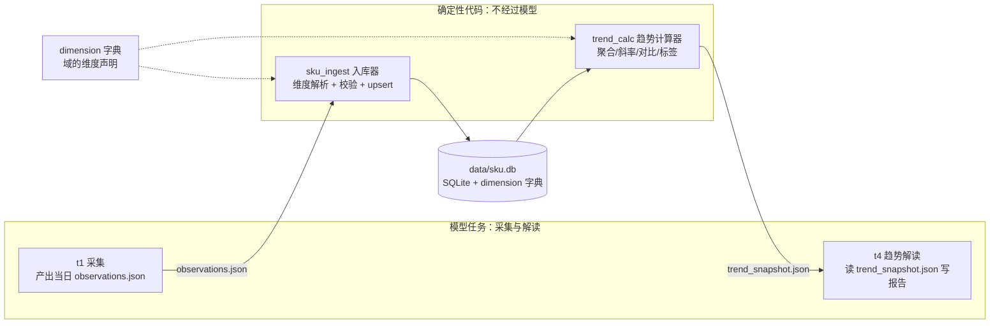
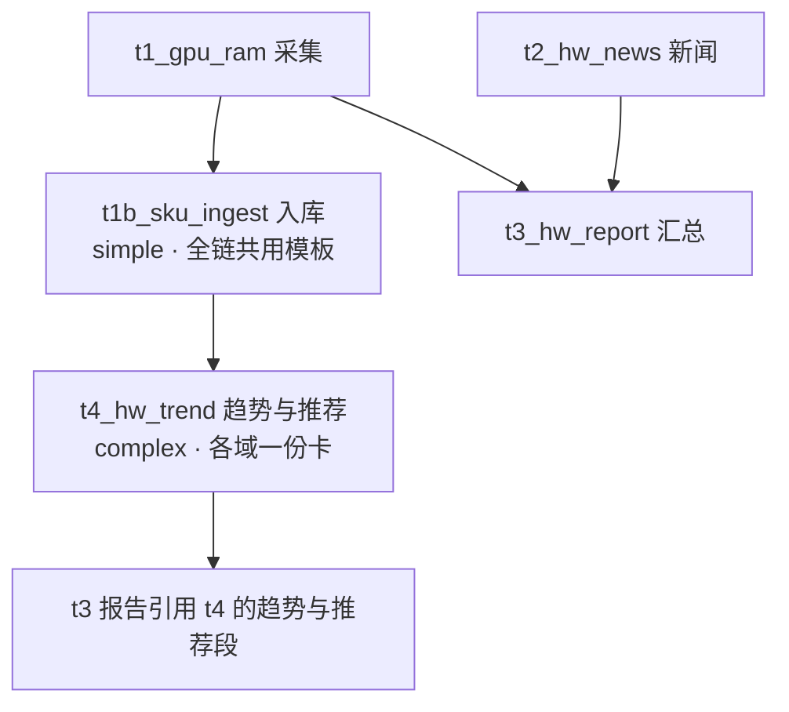

# 设计文档：通用实体时序观测库与趋势分析（sku.db）

> **存档版本 v2**（2026-10-10 模块化/抽象化重构）· 本文件是历史存档，不再更新。
> 当前评审稿见 `sku-timeseries-db-v3.1.md`；版本总索引见 `sku-timeseries-db.md`。

---

> 状态：**待评审（v2，按 2026-10-10 评审意见重构）** · 起草 2026-10-10
> 适用范围：orchestrator 全部调研链（硬件 / 房产 / 未来的任意域）
> 评审方式：文末「开放问题清单」需拍板，其余为实现细节可后续调整。

**v2 修订记录**（评审意见：模块化与抽象化，不许为单一域定制）：
- ~~序列 = (domain, canonical_name, channel)~~ → **序列 = 域声明的身份维度元组**；
  channel 从硬编码枚举降级为普通修饰维度；
- 新增**维度模型**（§4 D2）：身份维度 / 修饰维度 / 聚合粒度三层抽象，
  显卡的品牌型号与房产的小区楼层用同一套机制表达；
- 新增**控制变量对比**（contrast）作为趋势计算器的一等输出：
  「同楼不同楼层价差」「同型号不同品牌价差」都是同一计算；
- 核心表结构域无关：域特有知识全部外置到 `dimension` 字典表。

---

## 1. 背景与目标

用户需求（2026-10-10 原话归纳）：

1. **SKU 级逐日记录**：如 RTX 5060 Ti 8G 每日低价入库（含店铺信息、优惠券情况），
   逐日累积观察变化趋势；
2. **价格趋势分析**：哪些 SKU 在快速下降、哪些在快速拉高、哪些趋平稳可以入手；
3. **综合推荐建议**：最近哪款涨得高、哪款性价比高、装机推荐哪款；
4. **跨域范式**：不止显卡——楼市某楼盘某户型的价格变化同样入库，
   随时间绘制趋势，判断「哪一个可以入手、房价是否企稳」；
5. **（v2）高复用性**：每个功能做成通用抽象。价格的影响维度
   ——房产的楼层/楼栋、显卡的 AIC 品牌/显存规格——必须用同一套
   机制建模，而不是各域各写一套。

一句话：**给每日调研任务补一条纵向时间轴，且这条时间轴对任何域都成立**。

## 2. 现状诊断（为什么不能直接「把 CSV 存进库」）

拿 hardware_daily 的 t1_gpu_ram.csv 实测（2026-10-08 ~ 10-10 三天）：

| 日期 | 同一颗 RTX 5090 的「型号」写法 | 价格日期口径 |
|---|---|---|
| 10-08 | `GeForce RTX 5090(美行新卡最…)` | 2026-10-06 |
| 10-09 | `RTX 5090(国行整机参考)` | 2026-10-01 |
| 10-10 | `RTX 5090 (京东5090D 全新)` | 2026-10-03 |

三个致命问题：

- **实体命名漂移**：渠道/成色/AIC 品牌的后缀每天随机挂在型号字符串里，
  同一实体三天三个写法，跨日 join 不可能成立；
- **维度混杂**：单卡国行、整机参考、美行折算混在一列里，
  价格差出 2 倍（34999 vs 84899），纵向对比无意义；
- **环比是模型口算的**：`上期价格` 列大量「未查到」，涨跌幅随机缺失。

结论：**入库前必须先解决「序列身份」问题**。而身份问题的本质是
**维度问题**（§4 D2）：显卡的渠道、AIC 品牌与房产的楼层、楼栋
在数据模型里是同一种东西——影响价格、需要分离对比的**修饰维度**。

另一个现状约束：executor 渲卡/产物全部走文件（artifacts/），
模型没有也不应有直接写 DB 的能力（现有工具白名单：python/pytest/ruff/node，
文件写在 artifacts 下）。**写库与算趋势都应是确定性代码，模型只产数据与解读**。

## 3. 设计总览



分工铁律（与现有「验收防模型编数」的哲学一致）：

- **模型**：检索、抄录数字进结构化 JSON、解读趋势、写推荐叙事；
- **确定性代码**：维度解析（归一化）、入库、聚合与趋势指标计算。
  模型永远不直接读写 DB——trend_snapshot.json 里的每个数字都可由
  python_test 规则对 DB 重算复核。

## 4. 核心设计决策

### D1 数据库选型与位置：SQLite，`data/sku.db`

- 单机单写者（入库器），量级小（百实体 × 千日 = 十万行级），
  SQLite 绰绰有余，零部署；
- 与 `state/state.db`（任务状态机）**物理分离**——业务观测数据
  不与调度状态混库，损坏域隔离、备份策略独立；
- 预留 WAL 模式（读并发：趋势计算与人工查询可同时进行）。

### D2 维度模型（v2 核心）：身份维度 / 修饰维度 / 聚合粒度

**三层抽象，对任何域成立**：

| 层 | 语义 | 决定什么 | 例子（硬件） | 例子（房产） |
|---|---|---|---|---|
| **身份维度** identity | 实体「是什么」 | 序列的唯一键：一组身份维度值 = 一条实体记录 | `category=显卡, series=RTX 5060 Ti, spec=8GB` | `city=南京, estate=仁恒江湾城, layout=89㎡三房` |
| **修饰维度** attrs | 「同一实体的哪个变体/哪笔报价」 | 观测行的属性，可随时间变化、可对比、可聚合 | `vendor=七彩虹, channel=国行单卡, cooler=双风扇` | `floor_band=中楼层, building=3栋, orientation=南` |
| **聚合粒度** series | 趋势线画到哪一层 | 计算器按 identity（默认）或 identity+某修饰维度切序列 | 「5060Ti 市场价」= identity 聚合；「七彩虹 5060Ti 走势」= +vendor 切片 | 「小区 89㎡ 行情」= identity 聚合；「同小区不同楼层价差」= +floor_band 对比 |

**为什么身份与修饰分开、且都由域声明**（评审意见的落点）：

- 「同一品牌不同型号有差异」→ 型号(series)是身份维度，天然各画各线；
- 「同型号不同品牌有差异」→ AIC 品牌(vendor)是修饰维度，
  **控制变量对比**（固定型号、变 vendor）直接给出各组价格与差价；
- 「同一栋楼楼层不同价格不同」→ floor_band 修饰维度，
  固定小区户型、变楼层段对比；
- 「不同小区同楼层也有正常价差」→ 固定楼层段、跨 estate 对比——
  同一个 contrast 计算，只是换了切片维度。

核心表结构因此**域无关**：不出现 vendor/floor 这样的硬编码列，
域特有知识全部放在 `dimension` 字典表（§5），加新域 = 插字典行 + 
归一化规则集，核心代码零改动。

**修饰维度何时升格为身份维度**：当某变体成为长期独立跟踪目标
（如「七彩虹 5060Ti 战斧版」要单独盯），把它从 attrs 挪进该域的
identity 声明即可——字典表一改，历史观测按新维度重投影
（观测行的 attrs_json 保留原值，重投影是纯查询操作，不搬数据）。

### D3 实体解析：字典驱动 + 确定性规则，模型只给提示

入库器解析流程（对任何域相同）：

1. 读该域 `dimension` 声明（身份维度名单、修饰维度名单与合法值、
   归一化规则集）；
2. 确定性归一化：硬件域规则（剥渠道/成色括号后缀、全半角、
   `ti→Ti`、显存 `8G→8GB`）；房产域规则（小区名 `·` 分隔统一、
   「XX府=XX·府」别名、楼层归段 `3/18→低楼层`）——规则集本身
   是字典的一部分；
3. 查实体注册表（identity 维度值完全匹配）与别名表；
4. 模型产出的 `identity_hint` 仅作提示，**入库器最终裁决**；
5. 仍未命中的行进**隔离区**（quarantine 表），不进主数据——
   宁缺毋滥，隔离区增量每天在日报里报数，高频新实体定期收编。

### D4 模型只产 JSON，入库是确定性管道

t1 采集任务的新增副产物（与现有 CSV 并行）：

`artifacts/{date}/t1_sku_observations.json`（结构固定，任务卡内联形状）：

```json
[{
  "identity_hint": {"series": "RTX 5060 Ti", "spec": "8GB"},
  "attrs_hint": {"vendor": "七彩虹", "channel": "国行单卡"},
  "low_price": 2899.0,
  "raw_price": 3199.0,
  "price_date": "2026-10-10",
  "shop": {"name": "七彩虹京东自营旗舰店", "platform": "京东", "url": "…"},
  "coupons": [{"name": "满3000减200", "amount": 200, "threshold": 3000, "expire": "2026-10-15"}],
  "in_stock": true,
  "source_url": "…", "source_tier": "B"
}]
```

房产域同构：`identity_hint={"city":"南京","estate":"仁恒江湾城","layout":"89㎡三房"},
attrs_hint={"floor_band":"中楼层","building":"3栋"}`。

- hint 的 key 必须在该域 dimension 声明内，未声明的 key 进隔离区
  （防止模型发明维度污染字典）；
- 入库器做行级校验（价格数值域、日期不晚于采集日、店铺字段齐全），
  坏行进隔离区并计数告警。

### D5 趋势与对比：确定性计算，输出 trend_snapshot.json

计算器对**每个聚合序列**计算（窗口按观测期数，硬件=自然日、楼市=期）：

| 指标 | 定义 |
|---|---|
| `d1_pct` | 最新序列点对前一点的环比 % |
| `avg_7` / `slope_7` | 近 7 期均价；对 (期, 价) 最小二乘斜率（%/期） |
| `vol_7` | 近 7 期序列点标准差 / 均值 |
| `min_30` / `pct_from_low` | 近 30 期最低；现价距低点 % |
| `label` | `fast_drop`(≤-1%/期) / `drop` / `stable`(\|slope\|<0.2% 且 vol<2%) / `rise` / `fast_rise`(≥+1%/期) / `near_low`(距低点≤3%) |
| `sufficiency` | 覆盖期数 <5 标 `insufficient_data`，报告不得下趋势结论 |

序列点 = 聚合规则（默认：该 identity（或 identity+切片维度）当日
所有观测行的 `min(low_price)`；可按域配置为 median）。

**对比段（contrast，v2 新增，控制变量法）**：

```json
"contrasts": [{
  "domain": "hardware",
  "fixed": {"identity": {"series": "RTX 5060 Ti", "spec": "8GB"}},
  "vary": "vendor",
  "groups": [
    {"when": {"vendor": "公版"},    "last": 2999, "slope_7": -0.3},
    {"when": {"vendor": "七彩虹"},  "last": 2899, "slope_7": -0.9},
    {"when": {"vendor": "微星"},    "last": 3099, "slope_7": 0.1}
  ],
  "spread_pct": 6.9
}]
```

房产的「同小区同户型不同楼层价差」「同楼层跨小区价差」是**同一条
计算**——换 `fixed` 与 `vary` 而已，计算器代码不感知域语义。
哪些对比进报告由 t4 任务卡的 domain 配置声明（如房产固定输出
`vary=floor_band` 与 `vary=estate` 两组）。

快照文件附 mermaid 数据段（每序列一条可直接渲染的 xychart 行），
t4 解读任务**逐字引用**。

### D6 入库触发方式（三案对比，推荐 B）

| 方案 | 做法 | 优点 | 缺点 |
|---|---|---|---|
| A. run_daily 后处理 hook | t1 DONE 后由 run_daily 调入库脚本 | 无新任务 | run_daily 是通用驱动器，塞业务专用逻辑污染它 |
| **B. 独立 simple 任务（推荐）** | 新任务 `t1b_sku_ingest`，complexity=simple、needs_web=false，卡上写明「执行 python -m tools.sku_ingest --date {date}」 | 有状态/重试/验收（python_test 查库行数），与现有 DAG 一致 | 模型可能不执行脚本——用验收兜底：当日 DB 新增行数≥10 否则 FAIL |
| C. verifier 通过后自动触发 | 验收管线内嵌 | 强绑定 | 验收语义被污染，回填/重跑语义混乱 |

入库任务模板**全链共用一份**（`templates/sku_ingest.yaml`），
各链以 task 形式引用而非各自复制——加新域不改任务编排。

### D7 幂等与重跑

- 入库唯一键 `(entity_id, obs_date, shop_platform, shop_name)`，
  重跑 upsert（ON CONFLICT DO UPDATE）——同日重跑不产生重复序列点；
- 趋势快照纯函数式重算，天然幂等；
- 回填：`python -m tools.sku_ingest --date 2026-09-29 … 2026-10-10`
  复用同一命令（历史 CSV 需先补 observations.json——见 §10）。

## 5. 数据模型（DDL，核心表域无关）

```sql
-- 维度字典：域的知识全部在这里，核心表不出现任何域特有列
CREATE TABLE dimension (
  domain     TEXT NOT NULL,
  kind       TEXT NOT NULL,      -- identity / attr / aggregate_rule / normalizer
  key        TEXT NOT NULL,      -- 维度名（series/spec/vendor/floor_band…）
  value      TEXT,               -- 合法值枚举（attr 用；NULL=自由值）
  rule       TEXT,               -- 归一化规则（normalizer 用）
  PRIMARY KEY (domain, kind, key)
);
-- 示例数据：
-- ('hardware','identity','series',NULL,NULL)
-- ('hardware','attr','vendor','["公版","七彩虹","微星","华硕","技嘉",…]',NULL)
-- ('hardware','attr','channel','["国行单卡","整机参考","美行折算","二手"]',NULL)
-- ('housing','identity','estate',NULL,NULL)
-- ('housing','attr','floor_band','["低楼层","中楼层","高楼层","顶楼"]',NULL)
-- ('housing','normalizer','floor','3/18→低楼层',NULL)

-- 实体注册表：一行 = 一个被跟踪实体（身份维度值的组合）
CREATE TABLE entity (
  entity_id     INTEGER PRIMARY KEY,
  domain        TEXT NOT NULL,
  identity_json TEXT NOT NULL,   -- {"series":"RTX 5060 Ti","spec":"8GB"}（键序=字典声明序）
  display_name  TEXT NOT NULL,   -- 身份维度的确定性拼接（展示用）："RTX 5060 Ti 8GB"
  aliases       TEXT,            -- JSON：别名（归一化规则外的人工兜底）
  perf_anchor   REAL,            -- 可选价值锚点（性价比分母，见开放问题 Q4）
  active        INTEGER NOT NULL DEFAULT 1,
  created_at    TEXT, updated_at TEXT,
  UNIQUE(domain, identity_json)
);

-- 观测表：一行 = 某实体某价格日某店铺的一笔报价
CREATE TABLE observation (
  id           INTEGER PRIMARY KEY,
  entity_id    INTEGER NOT NULL REFERENCES entity(entity_id),
  obs_date     TEXT NOT NULL,    -- 价格日期（来源页面口径，非采集日）
  collected_on TEXT NOT NULL,    -- 采集日（= artifacts/{date}）
  low_price    REAL,             -- 券后到手价 / 单价（按 metric）
  raw_price    REAL,
  metric       TEXT NOT NULL DEFAULT 'price',  -- price / unit_price / rr_pct …（非价格指标同表复用）
  price_unit   TEXT NOT NULL DEFAULT 'CNY',    -- CNY / 元每平米 / % …
  attrs_json   TEXT,             -- {"vendor":"七彩虹","channel":"国行单卡"}（键必须在字典 attr 内）
  shop_name    TEXT, shop_platform TEXT, shop_url TEXT,
  coupons      TEXT,             -- JSON 数组
  in_stock     INTEGER,
  source_url   TEXT, source_tier TEXT,
  raw_json     TEXT,             -- 入库时整行快照（审计/重投影）
  created_at   TEXT,
  UNIQUE(entity_id, obs_date, shop_platform, shop_name)
);
CREATE INDEX idx_obs_entity_date ON observation(entity_id, obs_date);
-- 高频切片维度可加虚拟列加速（域接入时按需，非核心表必须）：
-- ALTER TABLE observation ADD COLUMN vendor TEXT
--   GENERATED ALWAYS AS (json_extract(attrs_json,'$.vendor')) VIRTUAL;
-- CREATE INDEX idx_obs_vendor ON observation(vendor);

-- 隔离区：解析失败/校验失败的行，主数据的看门人
CREATE TABLE observation_quarantine (
  id INTEGER PRIMARY KEY, collected_on TEXT, reason TEXT,  -- no_identity / unknown_attr_key / bad_price …
  raw_json TEXT, created_at TEXT
);
```

**身份升格示例**：某天要把 vendor 从修饰升为身份——dimension 表把
`vendor` 从 identity 集合挪进声明（或双列），实体注册表按新元组重建，
observation 的 attrs_json 原样保留参与重投影。**观测数据永不搬迁**。

## 6. 任务编排变更（以 hardware_daily 为例，其余域同构）



- **t1_gpu_ram（改）**：objective 增加副产物 `t1_sku_observations.json`
  （形状内联进卡，identity_hint/attrs_hint 按 §4 D4），
  「型号列写规范名，渠道/品牌/成色放 hint 字段，不许塞进型号串」；
- **t1b_sku_ingest（新，simple，全链共用一份模板）**：执行入库命令，
  验收 = python_test 查当日 collected_on 的新增/更新行数 ≥10
  且隔离区增量汇报；
- **t4_hw_trend（新，complex，各域一份卡：解读叙事与对比配置不同）**：
  读 trend_snapshot.json，产出 `hw_trend.md`（趋势榜 + 对比段 +
  mermaid 图 ≥3 张）+ `hw_recommend.json`（§7）；
- **t3_hw_report（改）**：inputs 增加趋势产物，「综合推荐」一节
  逐字引用 t4 结论并附图。

**验收门禁新增**（acceptance 层）：
- t4：python_test——从 DB 重算 3 个抽样序列的 `d1_pct/slope_7`
  及 1 组 contrast 与 trend_snapshot.json 一致（防模型改数）；
- t4：business_rule——`hw_recommend.json` 里每个被推荐实体必须
  存在于 trend_snapshot 且非 `insufficient_data`；
- t1：json_schema——observations.json 形状（hint 键与该域字典一致）。

## 7. 推荐建议的结构（hw_recommend.json，域无关字段名）

```json
{
  "date": "2026-10-10",
  "fast_dropping": [{"entity": "RTX 5060 Ti 8GB", "slope_7": -1.4}],
  "fast_rising":  [{"entity": "RTX 5090D 32GB", "slope_7": 1.8}],
  "stable_buy":   [{"entity": "DDR5 6000 16G×2", "vol_7": 0.9, "pct_from_low": 1.2}],
  "best_value":   [{"entity": "…", "value_per_yuan": 3.1, "vs_peer": "+18%"}],
  "notable_contrasts": [{"fixed": "…", "vary": "vendor", "takeaway": "七彩虹比公版低 3.3%"}],
  "build_advice": [{"budget": "6000-8000元", "gpu": "…", "reason": "…"}],
  "no_advice":    [{"entity": "…", "why": "insufficient_data"}]
}
```

推荐**叙事**由模型写（读快照），**入榜资格**由确定性标签决定——
模型只能从标签允许的池子里选，不能给数据不足的实体下结论。
`build_advice` 这类域特有段落留在各域的 t4 卡里，不进通用结构。

## 8. 数据质量防线

| 风险 | 防线 |
|---|---|
| 模型抄错价格（多零/少零） | 入库器数值域检查（与该序列近 7 期均值偏离 >50% 进隔离区 + P2 告警） |
| 维度伪装进型号串 / 模型发明维度 | 归一化剥离 + hint 键必须在字典声明内（`unknown_attr_key` 隔离） |
| 同日多店铺多价 | 全部入库（唯一键含店铺），序列点=当日聚合（默认 min，可配 median） |
| 修饰维度取值漂移（「中楼层」vs「中间层」） | attr 合法值枚举 + 归一化规则（楼层段映射） |
| 券过期导致口径漂移 | coupons 带 expire，趋势只看 low_price（券后），快照记 raw 价供参考 |
| 序列断档 | sufficiency 标签；报告禁言 |

## 9. 楼市域接入（P2，作为通用性的试金石）

不写任何楼市专用代码，只做两件事：

1. **dimension 字典插行**（housing 域声明身份/修饰/规则）+ 归一化规则集；
2. **两条链挂上共用入库任务**：
   - `housing_rr_fiveday` 的 `t_rr_top20.data.json`：identity=
     `{city, estate}`，metric 走 `rr_pct` 与 `unit_price` 双序列；
   - 楼盘户型跟踪（用户新提范式）：identity=`{city, estate, layout}`，
     attrs 挂 `floor_band/building`，「同楼不同层」「同层跨小区」
     由 contrast 直接输出。

若楼市接入时发现要改核心表/计算器，即为抽象失败的信号，
回到本档修订而非打补丁。

## 10. 历史回填

- 9-29 ~ 10-10 共 11 天 t1_gpu_ram.csv 可回填，但缺
  observations.json（渠道/店铺/券信息不在旧 CSV 里）——**只回填
  能可靠映射的行**（型号→identity 成功率预计 60-70%，其余进隔离区），
  用于把 `sufficiency` 从 1 期垫到 5+ 期；
- 回填前先跑 `--dry-run` 输出「旧型号串 → identity」映射表人工确认。

## 11. 分期实施

| 期 | 内容 | 交付物 |
|---|---|---|
| **P0** | DB schema（含 dimension 字典）+ 归一化器 + 入库器 + t1 模板改造 + 历史回填 | data/sku.db 开始累积 |
| **P1** | 趋势计算器（含 contrast）+ t4 任务 + 验收（python_test 复核）+ 报告改造 | 日报出现趋势榜、对比段与图 |
| **P2** | 推荐结构 + 楼市域接入（作为通用性验收） | 跨域范式成立 |

## 12. 开放问题清单（需评审拍板）

| # | 问题 | 我的倾向 |
|---|---|---|
| Q1 | dimension 字典的维护界面：直接改 DB vs yaml 入库（yaml 进 git 可评审） | yaml 为源、DB 为缓存（git 留痕） |
| Q2 | 隔离区收编流程：人工定期 vs 模型辅助提案+人工确认 | 后者（高频新实体收编快） |
| Q3 | 楼层粒度：精确层（3层）vs 分段（低/中/高/顶）入 attrs | 分段入 attrs、精确值留 raw_json（段内差异走对比原文） |
| Q4 | 价值锚点（性价比分母）：人工表 vs 检索跑分 | 人工维护小表（20-30 个主流实体），字段已在 entity 表预留 |
| Q5 | 趋势图粒度：每实体一图 vs 榜单聚合图 + top3 单品图 | 后者（图太多报告不可读） |
| Q6 | 观测日口径：页面标注 price_date vs 采集日 collected_on 作序列轴 | **price_date 为序列轴**（collected_on 仅审计），页面无日期时回落采集日并打标 |
| Q7 | 硬件域首发注册表清单（~30：50/40 系、9000 系、DDR5 主流、13600K/9800X3D 等） | 我出默认清单，评审时勾改 |
| Q8 | t4 频率：随链每日 vs 独立低频（趋势变化慢，每日=重复劳动） | 随链每日但输出增量段落（只有变化才进报告） |
| Q9 | attrs 合法值初版由谁定（vendor/floor_band 的取值表） | 我随 P0 出默认枚举，评审时勾改 |

---

附：本设计不改变现有「模型-验收-确定性代码」的权责边界，
新增的全部确定性组件（入库器/计算器）放 `orchestrator/tools/`，
与 `core/`（调度域）解耦。通用性的验收标准就是 §9：**楼市接入
零核心代码改动**。
