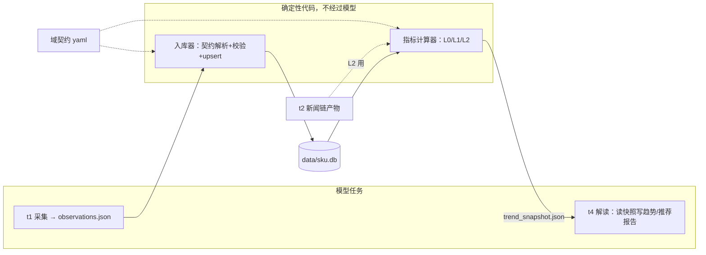
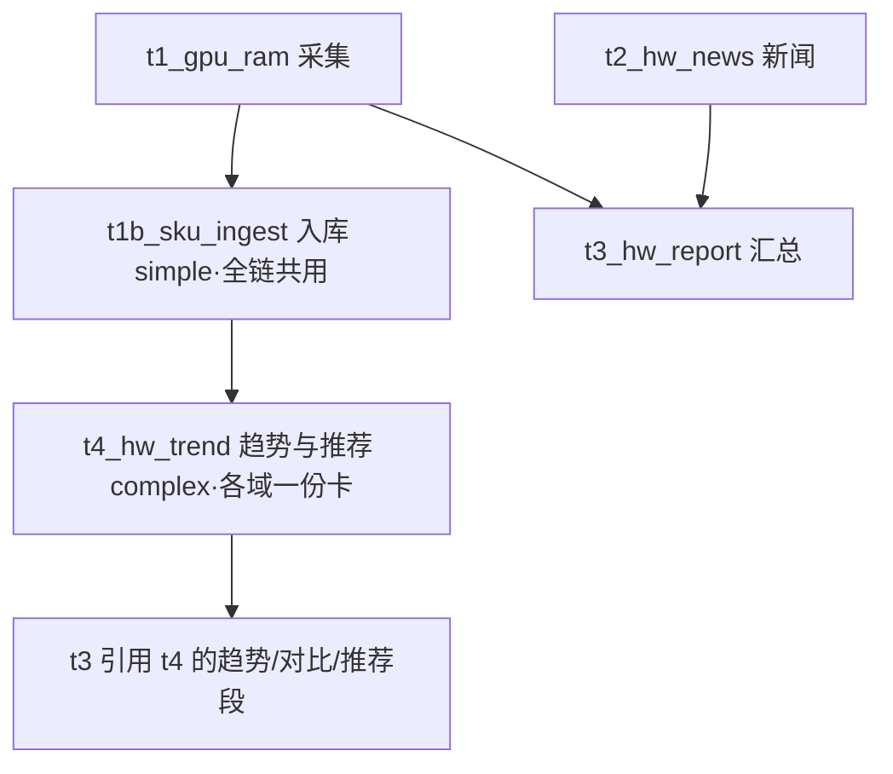

# 设计文档：通用实体时序观测库与趋势分析（sku.db）

> 状态：**待评审 v3.1** · 最后更新 2026-10-10
> 适用范围：orchestrator 全部调研链（硬件 / 房产 / 未来的任意域）
>
> **本稿是自包含的**：所有缩写、术语在 §0 术语表；每个待拍板的问题在
> §14 都带背景、选项与利弊展开——不需要翻聊天记录就能评审。

**v3.1 修订记录**（评审讨论结论并入）：
- 新增 **§0 术语表**；§14 开放问题全部改写为「背景+选项+利弊」卡片式；
- 维度哲学定调：**attrs 宽进（尽量多记）、identity 严出（序列键锁死）**；
- dimension 字典升格为**域契约文件**（interface/implementation 模式，
  见 §4 D3）；新增 §6 两域维度发散清单（含 geo 行政区划组、
  硬件全新/二手体系、跨域通用维度 condition/grade）；
- §9.0 指标层改为**双层视图**：decision（决策，硬闸门）/ narrative
  （叙事，服务流量），「不制造焦虑」从准入规则降级为**待效果验证的
  观察项**——是否要流量向包装、尺度多大，等有产出数据再定；
- 新增指标：贬值速度曲线、国补前后价、供需温度（由新维度涌现）；
- 历史数据回填源（爬取比价平台）从附注升格为独立开放问题 Q13。

---

## 0. 术语表（先读这节，后文所有缩写在这里查）

### 0.1 任务编号（t1/t1b/t2/t3/t4）

以现有的 hardware_daily 链为例，任务按 DAG 编号：

| 编号 | 任务 | 现状 |
|---|---|---|
| **t1** | `t1_gpu_ram` 行情采集：模型检索当日各硬件价格 → CSV | 已存在，本设计给它**加一个副产物** observations.json |
| **t2** | `t2_hw_news` 硬件新闻：模型检索新闻 → MD | 已存在 |
| **t3** | `t3_hw_report` 汇总：把 t1/t2 的产物拼成日报 | 已存在 |
| **t1b** | `t1b_sku_ingest` 入库（**新增**）：执行确定性脚本把当日 JSON 写入 sku.db | 本设计新增 |
| **t4** | `t4_hw_trend` 趋势与推荐（**新增**）：读计算器产出的快照，写趋势榜/对比/推荐 | 本设计新增 |

其他链（房产等）接入时用**同样角色**的任务，编号规则相同。

### 0.2 实施阶段（P0 / P1 / P1.5 / P2）

P = Phase，交付的先后顺序，数字越大越晚。每个阶段交付一部分能力，
前一阶段是后一阶段的输入：

- **P0** 地基：建库、入库器跑通，数据开始累积；
- **P1** 基础趋势：涨跌榜、对比表进日报；
- **P1.5** 行为指标：背刺风险、出价分位等（只用库内数据就能算，
  排在 P1 和 P2 之间是因为依赖 P1 但不需要库外数据）；
- **P2** 跨域信号与楼市接入：需要新闻/二手数据联算的指标 + 房产域。

### 0.3 指标层级（L0 / L1 / L2）

L = Layer，按「计算依赖深度 + 数据源范围」给指标分层（对应业界
「原子指标→派生指标→复合指标」的通用方法论）：

- **L0 基础趋势**：从原始观测一步算出（环比、斜率、波动率）；
- **L1 行为指标**：多步统计，仍只用本库数据（背刺风险、出价分位）；
- **L2 跨域信号**：要联合库外数据源才算得出（FOMO 温度计要新闻数据）。

分层的实用价值：数据门槛递增（告诉你什么时候能出什么结论）、
下层挂了上层照常出（故障隔离）、报告可标注结论的置信级别。

### 0.4 「期」

观测的时间单位，**不是固定天数**：硬件链每天采集 → 1 期 = 1 天；
房产链每 5 天采集 → 1 期 = 5 天。用「期」是为了同一套代码和门槛
定义对任何域都成立。下文「90 期」在硬件域≈3 个月，在房产链≈15 个月。

### 0.5 实体的三层结构（identity / attrs / observation）

- **identity（身份维度）**：实体「是什么」——决定唯一键。
  硬件如 `series=RTX 5060 Ti, spec=8GB`；房产如 `city=南京,
  estate=仁恒江湾城, layout=89㎡三房`；
- **attrs（修饰维度）**：同一实体的「哪个变体、哪笔报价」——
  硬件如 `vendor=七彩虹, condition=二手`；房产如 `floor_band=中楼层`。
  可以随时间变化、可用来切分对比（「同型号比品牌」「同户型比楼层」）；
- **observation（观测）**：一行 = 某实体某日在某店铺的一笔具体报价
  （价格、券、店铺、链接）。

### 0.6 action（推荐动作枚举）

推荐结论必须挂的可执行动作：`act_now` 现在买 / `wait` 等 /
`switch_to` 换目标（附店铺/型号/渠道）/ `lower_offer` 把出价压到
某分位（附目标）/ `probe_offer` 试探性低价（急售场景）。

### 0.7 其他高频词

- **contrast（控制变量对比）**：固定其余维度、只变一个维度，看各组
  价差。「同型号不同品牌价差」「同户型不同楼层价差」是同一条计算；
- **域契约**：每个域一份的声明文件（identity 维度名单、attrs 字段
  与合法值、归一化规则），见 §4 D3；
- **隔离区（quarantine）**：解析/校验失败的观测行的存放表——
  进不了主数据的行不丢弃，留待人工收编；
- **sufficiency（数据充分度）**：某指标要「至少多少期数据」才能算，
  不足时禁下结论（见 §9.4）；
- **序列**：可以画趋势线的最小单位 = identity（默认）或
  identity+某修饰维度（如「5060Ti 的七彩虹轨」）。

---

## 1. 背景与目标

用户需求（2026-10-10 归纳，逐条对应设计章节）：

1. **SKU 级逐日记录**（§5）：如 RTX 5060 Ti 8G 每日低价入库，
   含店铺信息、优惠券，逐日累积观察趋势；
2. **价格趋势分析**（§9 L0）：哪些在快速下降/拉高/趋平稳可入手；
3. **综合推荐建议**（§8）：哪款涨得高、哪款性价比高、装机推荐；
4. **跨域范式**（§11）：房产某楼盘某户型同样入库，判断是否企稳、
   何时入手；
5. **高复用性**（§4 D2/D3）：显卡的品牌型号与房产的小区楼层用
   同一套抽象；
6. **维度宁多勿少**（§6）：数据多了不可怕，少了才可怕——但
   attrs 宽进、identity 严出；
7. **新价值而非省时间**（§9）：提供慢慢买/什么值得买/闲鱼给不出
   的视角（跨域交叉、事前风险度量）；**流量也是需要的**——
   以双层视图并存（§9.0），情绪准入尺度等产出效果再定。

## 2. 现状诊断（为什么不能直接把 CSV 存进库）

hardware_daily 的 t1_gpu_ram.csv 实测（2026-10-08 ~ 10-10）：

| 日期 | 同一颗 RTX 5090 的「型号」写法 | 价格日期 |
|---|---|---|
| 10-08 | `GeForce RTX 5090(美行新卡最…)` | 2026-10-06 |
| 10-09 | `RTX 5090(国行整机参考)` | 2026-10-01 |
| 10-10 | `RTX 5090 (京东5090D 全新)` | 2026-10-03 |

三个问题：**实体命名漂移**（渠道/成色/品牌后缀随机挂在型号里，
跨日无法 join）；**维度混杂**（单卡/整机/美行混流，价差 2 倍）；
**环比是模型口算**（大量「未查到」）。结论：先解决序列身份
（identity 严出），再谈趋势。

现状约束：模型产物全部走文件（artifacts/），不应直接写 DB——
**写库与算指标都是确定性代码，模型只产数据与解读**。

## 3. 设计总览



## 4. 核心设计决策

### D1 存储：SQLite，`data/sku.db`

与 `state/state.db`（任务状态）物理分离；单机单写者量级足够；
WAL 模式留读并发。

### D2 维度模型：身份/修饰/聚合三层 + 宽进严出

三层结构见 §0.5。**宽进严出原则**：attrs 尽量多记（今天用不上
的维度是明天新视角的原料）；identity 锁死（防序列污染）。

- 「同品牌不同型号差异」→ 型号是 identity，各画各线；
- 「同型号不同品牌」「同楼不同楼层」「同层跨小区」→ 都是 contrast；
- 修饰维度可升格为身份（改契约，观测数据按新键重投影，**数据不搬迁**）。

### D3 域契约：interface / implementation（评审确认的方向）

用户直觉的 OOP 类比直接落地：

| OOP 世界 | 本设计 | 效果 |
|---|---|---|
| interface | 域契约文件（yaml）：声明 identity 维度、attrs 字段（类型/枚举/required 级）、归一化规则 | 入库器/计算器只依赖契约的**通用形态**，不认识具体字段 |
| implementation | hardware 契约、housing 契约各一份 | 品类 A 改字段只改 A 的契约，别的域与核心零感知 |
| 开闭原则 | 加新品类 = 新增一份契约 | 核心表/计算器/任务模板不开刀 |

对应数据领域成熟实践：EAV（Entity-Attribute-Value，医疗/电商 SaaS
处理异构品类的经典模型——attrs_json 即其 JSON 变体）+ Schema
Registry（数据自由流动、契约集中校验）。**反模式警示**：每域建
独立表最像「实现类」，但跨域通用计算要为每张表写一遍 SQL，
正好破坏顶层接口控制——不采用。

### D4 模型只产 JSON，入库是确定性管道

t1 的新副产物 `artifacts/{date}/t1_sku_observations.json`：

```json
[{
  "identity_hint": {"series": "RTX 5060 Ti", "spec": "8GB"},
  "attrs_hint": {"vendor": "七彩虹", "condition": "全新", "channel": "国行单卡"},
  "low_price": 2899.0, "raw_price": 3199.0, "price_date": "2026-10-10",
  "shop": {"name": "七彩虹京东自营旗舰店", "platform": "京东", "url": "…"},
  "coupons": [{"name": "满3000减200", "amount": 200, "threshold": 3000, "expire": "2026-10-15"}],
  "in_stock": true, "source_url": "…", "source_tier": "B"
}]
```

hint 是模型给的提示，**入库器按契约最终裁决**；hint 键必须在契约
声明内；解析/校验失败的行进隔离区（宽进的防线是键白名单，
不是拒收）。

### D5 指标计算：确定性（详见 §9）

序列点 = 该切片当日观测的聚合（默认 min，可按域配 median）。
trend_snapshot.json 附 mermaid 数据段，t4 只解读不改数。

### D6 入库触发：独立 simple 任务（t1b）

三案对比后选 B：t1b_sku_ingest 执行 `python -m tools.sku_ingest
--date {date}`，验收 = python_test 查当日入库行数。任务模板全链
共用一份。（A 方案污染通用驱动器；C 方案污染验收语义。）

### D7 幂等

唯一键 `(entity_id, obs_date, shop_platform, shop_name)`，重跑
upsert；指标纯函数重算。

## 5. 数据模型（核心表域无关 + 契约文件）

```sql
CREATE TABLE entity (
  entity_id     INTEGER PRIMARY KEY,
  domain        TEXT NOT NULL,
  identity_json TEXT NOT NULL,     -- 键序=契约声明序
  display_name  TEXT NOT NULL,     -- 展示名（确定性拼接）
  aliases       TEXT, perf_anchor REAL,
  active        INTEGER NOT NULL DEFAULT 1,
  created_at    TEXT, updated_at TEXT,
  UNIQUE(domain, identity_json)
);
CREATE TABLE observation (
  id INTEGER PRIMARY KEY,
  entity_id INTEGER NOT NULL REFERENCES entity(entity_id),
  obs_date TEXT NOT NULL,          -- 价格日（页面口径）
  collected_on TEXT NOT NULL,      -- 采集日
  low_price REAL, raw_price REAL,
  metric TEXT NOT NULL DEFAULT 'price',   -- price/unit_price/rr_pct…
  price_unit TEXT NOT NULL DEFAULT 'CNY',
  attrs_json TEXT,                 -- 修饰维度（键须在契约内）
  shop_name TEXT, shop_platform TEXT, shop_url TEXT,
  coupons TEXT, in_stock INTEGER,
  source_url TEXT, source_tier TEXT, raw_json TEXT,
  created_at TEXT,
  UNIQUE(entity_id, obs_date, shop_platform, shop_name)
);
CREATE INDEX idx_obs_entity_date ON observation(entity_id, obs_date);
CREATE TABLE observation_quarantine (
  id INTEGER PRIMARY KEY, collected_on TEXT, reason TEXT,
  raw_json TEXT, created_at TEXT);
```

**域长什么样全在契约文件**（`config/contracts/hardware.yaml` 示意）：

```yaml
domain: hardware
identity: [category, series, spec]        # 序列键
attrs:
  vendor:    {values: [公版, 七彩虹, 微星, 华硕, 技嘉], level: optional}
  condition: {values: [全新, 二手, 官翻, 展示机], level: required}   # 跨域通用维度
  channel:   {values: [国行单卡, 整机参考, 美行折算, 百亿补贴], level: required}
  grade:     {values: [95新, 9成新, 8成新, 7成新及以下], level: optional}  # 二手成色
  used_duration_months: {type: int, level: optional}
  promo_event: {values: [618, 双11, 国补, 以旧换新, 无], level: optional}
aggregate_rule: min        # 序列点=当日最低价
normalizers:               # 归一化规则（确定性）
  - strip_paren_suffix     # 剥「(京东全新)」类后缀
  - ti_case; gb_unit       # ti→Ti、8G→8GB
```

维度字典表（v2 的 dimension 表）退化为契约的**运行时缓存**，
yaml 是唯一源（git 可评审）。

## 6. 域维度清单（发散结果：宽进）

### 6.1 geo 行政区划组（跨域复用，房产用全）

```
province → city → district(区/县/县级市) → township(乡镇/街道) → block(板块)
```

- `city + district` 进 identity（防跨城同名小区撞键）；
- `township / block` 挂 attrs（板块归属会随规划调整，进 identity 会
  让实体键不稳定）；district 的层级（区 vs 县级市 vs 县）作为
  契约元数据声明，满足「明确它是区级还是乡镇级」的诉求。

### 6.2 房产域（identity / attrs / observation 三层）

| 层 | 维度 |
|---|---|
| identity | city, district, estate(小区), layout(户型) |
| attrs | block 板块, building 楼栋, floor_band 楼层段, exact_floor, orientation 朝向, decoration 装修, elevator, building_age 房龄, property_type 产权性质, school_district 学区, metro 最近地铁+距离, 满二满五, condition 新房/二手 |
| observation | 挂牌价/成交价, 议价空间(挂牌-成交), 在售套数, 带看量, 成交周期 |

学区/地铁/房龄是房产价格三大隐性因子，**漏了以后补不回来**。

### 6.3 硬件域（含全新/二手体系）

| 层 | 维度 |
|---|---|
| identity | category, series, spec, 代际(v2/v3), 电商专供版 |
| attrs | condition(全新/二手/官翻/展示机), vendor, channel, cooler 散热规格, cpu_box 散片/盒装, ram_grade 颗粒+时序, storage_type TLC/QLC, promo_event(618/双11/国补/以旧换新), warranty_left 保修剩余, grade 几成新, used_duration_months 使用月数, accessories 配件齐全度, seller_type 个人/商家, mine_risk 疑似矿卡 |
| observation | raw/low_price, coupons, in_stock, 赠品, 保修政策变化 |

### 6.4 跨域通用维度（抽象的验证）

- **condition（全新/二手）**：硬件的全新/二手 = 房产的新房/二手，
  同一维度名跨域声明；
- **grade（成色）**：硬件的几成新 ↔ 房产的房龄+装修——都是
  「使用损耗的等级化」。

### 6.5 required / optional 分级

契约里每个维度标必填级：required 缺失进隔离区（保证核心序列质量），
optional 缺失静默（宽进不等于全都强制）——防任务卡 token 膨胀
与模型低可靠性维度的噪声。

## 7. 任务编排（以 hardware_daily 为例）



验收：t4 的 python_test 从 DB 重算抽样指标与快照一致（防模型改数）；
推荐入榜实体必须 sufficiency 达标。

## 8. 推荐输出（hw_recommend.json，动作化）

每个结论必须带 `action`（§0.6）——挂不上动作的结论不进推荐：

```json
{
  "date": "2026-10-10",
  "decisions": [
    {"entity": "RTX 5060 Ti 8GB", "signal": "stable_buy",
     "evidence": "vol_7=0.9%, 距30期低点+1.2%, stab_risk中位=4%",
     "action": "act_now"},
    {"entity": "RTX 5090D 32GB", "signal": "fast_rise",
     "evidence": "slope_7=+1.8%/期, fomo_index=78",
     "action": "wait", "note": "情绪过热，等斜率走平"}
  ],
  "notable_contrasts": [
    {"fixed": "RTX 5060 Ti 8GB", "vary": "vendor",
     "takeaway": "七彩虹比公版低3.3% → action=switch_to"}]
}
```

## 9. 指标层（三级 + 双层视图）

### 9.0 双层视图（v3.1 定调）

| 层 | 内容 | 闸门 |
|---|---|---|
| **decision_view** | 给待决策者：趋势榜、背刺风险、act_now/wait | 硬闸门：受众=待决策者、结论必挂 action |
| **narrative_view** | 同一批数字的传播包装（流量向标题/榜单） | **暂不设情绪准入**（观察项 O1，见 §14 末） |

唯一底线：**叙事层只能引用确定性指标，不能创造数字**——情绪可以
放大，数据不能编，否则反噬整个库的可信度。「要不要/多大尺度」
等产出效果数据后再定。

### 9.1 L0 基础趋势（P1）

`d1_pct` 环比 / `slope_7` 近7期斜率 / `vol_7` 波动率 / `min_30`
`pct_from_low` 距低点 / `label` 趋势标签 / `contrast` 控制变量对比。
门槛：≥5 期。

### 9.2 L1 行为指标（P1.5，纯库内，全部事前化）

| 指标 | 一句话定义 | 对冲 | 门槛 | action |
|---|---|---|---|---|
| `stab_risk` | 若今日买入，历史相似处境者 30 期内最大回撤的中位数 | 嗔 | 60期 | wait/act_now |
| `wait_value` | 历史上「再等 90 期」平均省多少 | lust | 120期 | wait |
| `anchor_check` | 声称原价在序列历史的真实出现率 | 痴 | 30期 | switch_to/拒下单 |
| `sloth_tax` | 同日跨平台价差 | sloth | 当日≥2平台 | switch_to |
| `offer_percentile` | 目标价在近 90 期成交分布的分位 | envy | 20期 | lower_offer |
| `flagship_premium` | 比甜蜜点多付的钱中，性能支撑多少、溢价多少 | gluttony/pride | 锚点齐 | switch_to |
| `distress_signal` | 偏离同小区中位数+降幅陡 → 急售疑似 | 痴 | 30期 | probe_offer |
| **`depreciation`** 贬值速度（新增） | 二手按 grade/used_duration 回归：每多用一月折价多少；房产按房龄 | 痴 | 60期 | switch_to(更新成色目标价) |
| **`promo_delta`** 国补前后价（新增） | 同实体促销事件内外的真实到手价差 | 痴 | 30期+事件标注 | act_now(窗口内)/wait |

### 9.3 L2 跨域信号（P2）

| 指标 | 数据组合 | action |
|---|---|---|
| `fomo_index` | 价格斜率×二手挂牌量×新闻提及密度 → 0-100 | >70 时 action 强制 wait |
| `arb_window` | 国行 vs 美行价差 vs 关税运费阈值 | probe_offer |
| `stabilization` | 波动收敛×价差收敛×供需信号 | act_now(房产窗口) |
| **`supply_heat`** 供需温度（新增） | 在售套数+带看量+议价空间（房产版 FOMO） | wait/probe_offer |

### 9.4 sufficiency 分级

L0 ≥5 期；`stab_risk` ≥60、`wait_value` ≥120 期；其余 L1/L2
20-30 期。不足时**显示占位**（「样本 23/60 期，预计 X 日可用」），
不隐藏——诚实优于留白（Q12 待最终确认）。

## 10. 数据质量防线

抄错价（偏离近7期均值>50%→隔离区+告警）；发明维度（键白名单）；
取值漂移（枚举+归一化）；断档（sufficiency 禁言）；**指标被模型
改写**（t4 验收从 DB 重算）。

## 11. 楼市域接入（P2，通用性试金石）

零核心代码改动，只做：契约插一份 + 两条链挂共用入库任务
（rr_top20：identity={city,estate}，metric=rr_pct/unit_price 双序列；
楼盘户型：identity={city,district,estate,layout}）。楼市视角全部由
通用指标覆盖：offer_percentile / distress_signal / stabilization /
depreciation(房龄折价)。**若接入需要改核心表或计算器 = 抽象失败**。

## 12. 历史回填

自采历史仅 11 天（9-29~10-10），L1 的 60-120 期门槛若靠自然累积
要 2-4 个月——**不值得傻等**（用户定调）。回填源与策略见 Q13。

## 13. 分期实施

| 阶段 | 内容 | 交付 |
|---|---|---|
| P0 | 表+契约框架+入库器+t1 改造+历史回填 | sku.db 累积 |
| P1 | L0 趋势+contrast+t4+验收+报告改造 | 趋势榜/对比/图进日报 |
| P1.5 | L1 行为指标（stab_risk 等，含 Q13 回填加速） | 推荐 action 化 |
| P2 | L2 跨域信号+楼市接入 | 跨域范式成立 |

## 14. 开放问题清单（每题带背景与选项，请逐题拍板）

> **Q1 契约文件用什么格式维护？**
> 背景：域契约（§4 D3）是「某品类有哪些维度、合法值、归一化规则」
> 的唯一声明，改它=改品类行为。它需要被 git 记录、被人工评审。
> 选项：a) 直接改数据库里的字典表——快但无评审痕迹，改坏了难回溯；
> b) **yaml 文件为源、DB 只是运行时缓存**（我的倾向）——每次改契约
> 都是一次 commit，谁改的、为什么改、diff 一目了然。

> **Q2 隔离区里解析失败的新实体（新显卡/新小区），怎么收编进正式实体表？**
> 背景：模型每天可能报出库里没有的新 SKU，按「宁缺毋滥」进隔离区，
> 但不能永远隔离着（否则库不增长）。选项：a) 人工定期翻隔离区手动
> 建 entity；b) **模型辅助提案**（对隔离行聚类+建议 identity，人工
> 确认后入库，我的倾向）——高频新实体收编快，人工只做最后确认。

> **Q3 楼层记多细？**
> 背景：房产楼层影响价格（你点名过），但精确到「3 层」会让序列切得
> 极碎（同小区同户型每层一条线，数据永远不够）。选项：a) 精确层
> 入 identity；b) **分段（低/中/高/顶）入 attrs、精确层留原始快照**
> （我的倾向）——趋势按段画，段内差异需要时从原始数据翻查。

> **Q4 性价比的「性能锚点」从哪来？**
> 背景：`flagship_premium`（旗舰溢价）要算「每块钱买多少性能」，
> 性能是个外部常识（5060Ti 比 4060Ti 强约 X%），价格库本身不含。
> 选项：a) **人工维护一张小表**（首发 30 个主流实体，我的倾向）——
> 一次性成本半小时，数据可靠；b) 让模型检索跑分——省人工但数字
> 不可控，违背「确定性指标」原则。entity 表的 perf_anchor 字段已预留。

> **Q5 趋势图怎么配？**
> 背景：日报里 mermaid 图数量影响可读性。选项：a) 每实体一张
> （30 个 SKU=30 张图，没法看）；b) **榜单聚合图+top3 单品图**
> （我的倾向）——一张「涨跌榜全景」+ 三张重点单品走势。

> **Q6 序列的时间轴用哪个日期？**
> 背景：一笔观测有两个日期：价格日期（来源页面标注「10-06 的价」）
> 和采集日（我们 10-08 抓到的）。选项：a) **价格日期为轴**（我的
> 倾向）——反映真实市场时间，回填历史时不错位；页面没标日期时
> 回落采集日并打标（知道这行有口径风险）；b) 采集日为轴——整齐
> 但把滞后也算进市场时间。

> **Q7 硬件首发跟踪哪 30 个实体？**
> 背景：P0 要先建注册表（首发清单决定 t1 每天盯什么）。我出默认
> 清单（50 系：5090/5080/5070Ti/5070/5060Ti/5060/5050；40 系过渡款；
> AMD 9070XT/9060；CPU：9800X3D/9700X/14600K/265K；DDR5 主流
> 频率容量；旗舰固态）——**评审时你勾改**，不是问题是要确认。

> **Q8 t4（趋势与推荐任务）跑多频？**
> 背景：t4 是新增的「读快照写趋势报告」任务（§0.1）。趋势变化慢，
> 每天全量写=大量重复内容。选项：a) **随链每日跑但只输出增量段**
> （我的倾向）——有变化才进日报，无变化一行「今日无显著变化」；
> b) 独立低频链（如每周）——省算力但错过突变日。

> **Q9 attrs 合法值初版枚举谁定？**
> 背景：契约里每个维度要有合法值（vendor 有哪些品牌、楼层分几段）。
> 我的倾向：**随 P0 我出默认枚举，评审勾改**——同 Q7 性质。

> **Q10 `stab_risk`（背刺风险）用哪档算法？**
> 背景：「若今日买入，历史上像现在这样的时刻，买完 30 期内最大回撤
> 多少」——核心问题是什么算「像现在」。选项：
> a) **全史中位数**（P1.5，我的倾向）：对该实体全部历史买入日算
> 回撤取中位数。利：60 期数据就能算、简单可解释（「随便哪天买的
> 人，一半被套不超过 X%」）；弊：不分场合——顶部买入和底部买入
> 风险天差地别，给的是「平均命运」；
> b) **特征匹配**（数据≥200 期后加，P2）：先用「价格分位×斜率
> 标签×新品发布窗口」给当下画像，只统计历史相似处境的回撤。
> 利：针对性强，才是真正的「你的处境的风险」；弊：切格子后样本
> 骤减（60 期每格不到 2 个样本）、特征选择主观易过拟合。
> 两版可并行输出互相校准——先 a 后 b 不是替换关系。

> **Q11 `fomo_index` 三个因子（价格斜率/二手挂牌/新闻密度）的权重？**
> 背景：L2 情绪分数是三因子加权合成 0-100。选项：a) **等权起步**
> （我的倾向），积累数据后回归调参——权重放契约里可配，改权重
> 不改代码；b) 一开始就拍权重——无依据，容易拍错还难解释。

> **Q12 样本不足时显示占位还是隐藏？**
> 背景：某实体只有 23 期数据、stab_risk 要 60 期。选项：
> a) **显示占位**（我的倾向）：「stab_risk：样本 23/60，预计 11-02
> 可用」——诚实、自带路线图、用户不会当系统坏了；b) 隐藏：界面
> 干净但缺数据会被疑为故障。配合 Q13 回填后此问题影响面缩小到
> 新实体冷启动期。

> **Q13 历史数据回填：要不要爬比价平台（慢慢买/什么值得买）？**
> 背景：L1 指标要 60-120 期，自采才 11 期。自然累积要 2-4 个月，
> 「傻等 120 天得出不结论」不可取（你的原话）。选项：
> a) **爬慢慢买历史页一次性回填 1-2 年**（我的倾向）：主流 30 实体
> 每个只爬一次，低频几乎无反爬压力。已知代价：①口径映射——它
> 跟踪的是具体电商商品条目，我们是型号聚合，爬回数据走 attrs
> 分轨（`source=manmanmai`）不与自采混线；②它记的是页面标价
> 不含券后价，只用作 stab_risk 历史铺垫，序列点仍以自采为准；
> ③ToS 灰色地带——自用研究、限频、不转售，风险可控但要控制节奏；
> ④页面改版才需要维护爬虫。
> b) 只靠自采自然累积——零风险但 2-4 个月内 L1 全线「样本不足」；
> c) 折中：只回填 top10 热门实体（覆盖最常问的 SKU）。

**观察项（暂不决策）**
- **O1 叙事层尺度**：narrative_view（§9.0）要不要做、情绪包装到什么
  程度——等 decision_view 产出效果数据后再定（你的定调）。

---

附：确定性组件放 `orchestrator/tools/`；两条验收标准——**楼市接入
零核心代码改动**（抽象成立）、**每个 decision 指标挂得上 action**
（准入成立）。
