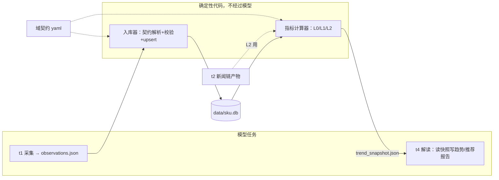
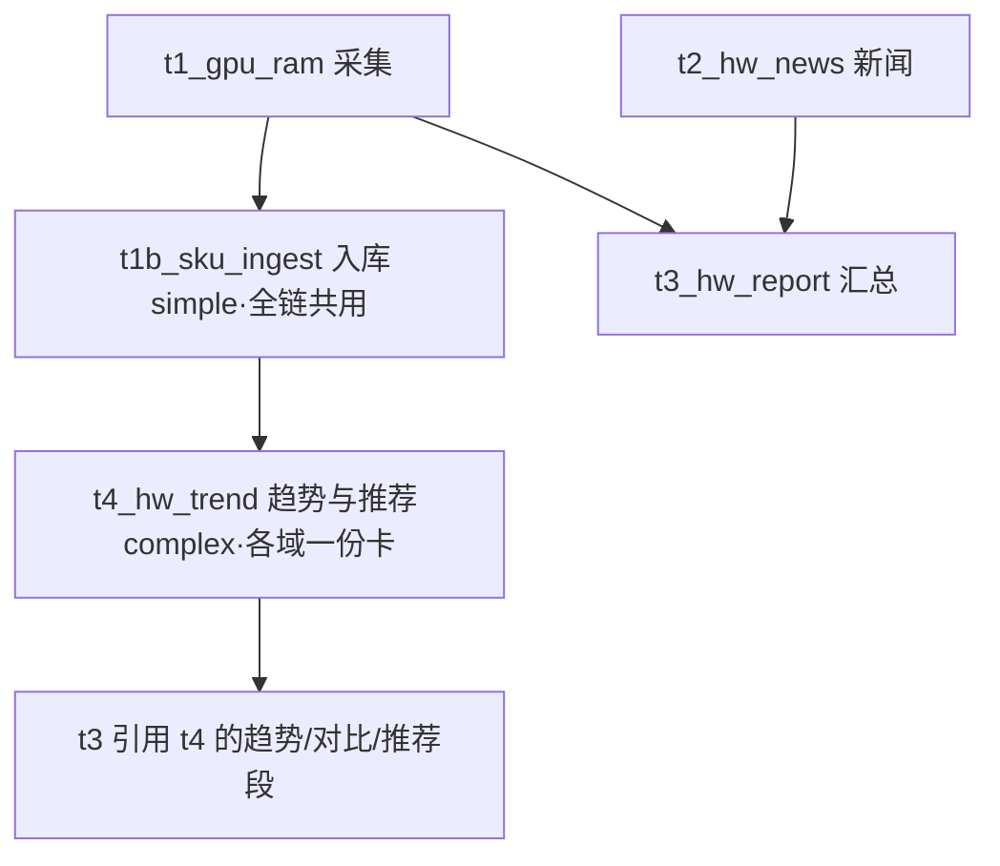

# 设计文档：通用实体时序观测库与趋势分析（sku.db）

> 状态：**v3.3（实施前质检修正版，P0 启动稿）** · 最后更新 2026-10-10
> 适用范围：orchestrator 全部调研链（硬件 / 房产 / 未来的任意域）
>
> **本稿是自包含的**：所有缩写、术语在 §0 术语表；§14 是评审决策记录
> （2026-10-10 用户逐题拍板）+ 质检修正记录。

**v3.3 修订记录**（实施前质检：4 矛盾 / 5 边界 / 4 待细化，全部修正）：
- **M1 二手污染全新序列**：v3 把 condition 降为 attrs 后，min 聚合会把
  二手价混进全新序列点——新增 **aggregate_scope 契约声明**（§4 D2），
  默认聚合只在 `condition=全新` 观测内取，二手为平行切片；
- **M2 回填口径混轨**：`source` 进聚合分组；stab_risk 允许用回填源
  切片计算但必须标注 `basis=标价近似`（§9.5 适用矩阵）；
- **M3 模型闭环 vs 不碰 DB 铁律**：收编改为「判断与执行分离」——
  模型产出**收编提案 JSON**，确定性脚本校验后执行写库（§4 D4）；
- **M4 mermaid 验收 vs 增量链接冲突**：验收改写为「有显著变化的
  实体必须配图；无变化日至少 1 张全局汇总图」，显著变化阈值
  （label 变化或 |d1|>1%）进契约可配（§7）；
- **B1 升格外键断裂**：新增 `entity_lineage` 映射表，observation
  永不改行（§5）；
- **B2 快照生成时机**：t1b 顺序执行 ingest+calc 两个确定性脚本，
  t4 纯解读，验收加「快照时间戳=当日」（§7）；
- **B3 手机数据入口**：所有渠道终归 observations.json + 入库器
  **单一入口**（§12）；
- **B4 行政区划变更**：旧 district 名进 aliases 兜底（§10）；
- **B5 占位预估**：「预计 X 日可用」按数据实况动态计算（§9.4）；
- **N1 契约 schema 补全**（aggregate_scope/metric/sufficiency/threshold，
  §5）；**N2 指标×metric×source 适用矩阵**（§9.5）；**N3 收编提案
  格式**（§4 D4）；**N4 变化阈值与链接锚点**（§7）。

**v3.2 修订记录**（2026-10-10 评审拍板并入）：
- **Q1-Q15 全部决策完毕**（见 §14 决策记录表），设计清零、P0 解锁。
  关键修正：
  ①Q2 隔离区收编升级为**模型自动闭环**（判断写错 vs 新品、自动执行、
  人工仅周报抽检）；②Q4 性能锚点改为**相对锚点体系**（同代销量最大者
  =1.0，其余为倍数；房产以主流价格区间为锚，特殊楼层/带院子为倍数）；
  ③Q5 趋势图改为**每实体一张**（主流 ~20 个实体）；④Q8 无显著变化时
  **链接到前一日报告**（增量引用）；⑤Q13 采集渠道矩阵成型，
  **手机自动化（荣耀采集机）为反爬终极兜底**；
- 新增遗留问题 Q14（锚点实体的销量判定数据源）、Q15（手机采集的
  节奏与账号策略）——**同日随后拍板**：Q14 手机看官方旗舰店销量/
  评论量定基底；Q15 关闭（不预设 SOP，触发反爬再临场处理）。
  至此开放问题清零。

---

## 0. 术语表（先读这节，后文所有缩写在这里查）

### 0.1 任务编号（t1/t1b/t2/t3/t4）

以现有的 hardware_daily 链为例，任务按 DAG 编号：

| 编号 | 任务 | 现状 |
|---|---|---|
| **t1** | `t1_gpu_ram` 行情采集：模型检索当日各硬件价格 → CSV | 已存在，本设计给它**加一个副产物** observations.json |
| **t2** | `t2_hw_news` 硬件新闻：模型检索新闻 → MD | 已存在 |
| **t3** | `t3_hw_report` 汇总：把 t1/t2 的产物拼成日报 | 已存在 |
| **t1b** | `t1b_sku_ingest` 入库（**新增**）：执行确定性脚本把当日 JSON 写入 sku.db | 本设计新增 |
| **t4** | `t4_hw_trend` 趋势与推荐（**新增**）：读计算器产出的快照，写趋势榜/对比/推荐 | 本设计新增 |

其他链（房产等）接入时用**同样角色**的任务，编号规则相同。

### 0.2 实施阶段（P0 / P1 / P1.5 / P2）

P = Phase，交付的先后顺序，数字越大越晚。每个阶段交付一部分能力，
前一阶段是后一阶段的输入：

- **P0** 地基：建库、入库器跑通，数据开始累积；
- **P1** 基础趋势：涨跌榜、对比表进日报；
- **P1.5** 行为指标：背刺风险、出价分位等（只用库内数据就能算，
  排在 P1 和 P2 之间是因为依赖 P1 但不需要库外数据）；
- **P2** 跨域信号与楼市接入：需要新闻/二手数据联算的指标 + 房产域。

### 0.3 指标层级（L0 / L1 / L2）

L = Layer，按「计算依赖深度 + 数据源范围」给指标分层（对应业界
「原子指标→派生指标→复合指标」的通用方法论）：

- **L0 基础趋势**：从原始观测一步算出（环比、斜率、波动率）；
- **L1 行为指标**：多步统计，仍只用本库数据（背刺风险、出价分位）；
- **L2 跨域信号**：要联合库外数据源才算得出（FOMO 温度计要新闻数据）。

分层的实用价值：数据门槛递增（告诉你什么时候能出什么结论）、
下层挂了上层照常出（故障隔离）、报告可标注结论的置信级别。

### 0.4 「期」

观测的时间单位，**不是固定天数**：硬件链每天采集 → 1 期 = 1 天；
房产链每 5 天采集 → 1 期 = 5 天。用「期」是为了同一套代码和门槛
定义对任何域都成立。下文「90 期」在硬件域≈3 个月，在房产链≈15 个月。

### 0.5 实体的三层结构（identity / attrs / observation）

- **identity（身份维度）**：实体「是什么」——决定唯一键。
  硬件如 `series=RTX 5060 Ti, spec=8GB`；房产如 `city=南京,
  estate=仁恒江湾城, layout=89㎡三房`；
- **attrs（修饰维度）**：同一实体的「哪个变体、哪笔报价」——
  硬件如 `vendor=七彩虹, condition=二手`；房产如 `floor_band=中楼层`。
  可以随时间变化、可用来切分对比（「同型号比品牌」「同户型比楼层」）；
- **observation（观测）**：一行 = 某实体某日在某店铺的一笔具体报价
  （价格、券、店铺、链接）。

### 0.6 action（推荐动作枚举）

推荐结论必须挂的可执行动作：`act_now` 现在买 / `wait` 等 /
`switch_to` 换目标（附店铺/型号/渠道）/ `lower_offer` 把出价压到
某分位（附目标）/ `probe_offer` 试探性低价（急售场景）。

### 0.7 其他高频词

- **contrast（控制变量对比）**：固定其余维度、只变一个维度，看各组
  价差。「同型号不同品牌价差」「同户型不同楼层价差」是同一条计算；
- **域契约**：每个域一份的声明文件（identity 维度名单、attrs 字段
  与合法值、归一化规则），见 §4 D3；
- **隔离区（quarantine）**：解析/校验失败的观测行的存放表——
  进不了主数据的行不丢弃，留待人工收编；
- **sufficiency（数据充分度）**：某指标要「至少多少期数据」才能算，
  不足时禁下结论（见 §9.4）；
- **序列**：可以画趋势线的最小单位 = identity（默认）或
  identity+某修饰维度（如「5060Ti 的七彩虹轨」）。

---

## 1. 背景与目标

用户需求（2026-10-10 归纳，逐条对应设计章节）：

1. **SKU 级逐日记录**（§5）：如 RTX 5060 Ti 8G 每日低价入库，
   含店铺信息、优惠券，逐日累积观察趋势；
2. **价格趋势分析**（§9 L0）：哪些在快速下降/拉高/趋平稳可入手；
3. **综合推荐建议**（§8）：哪款涨得高、哪款性价比高、装机推荐；
4. **跨域范式**（§11）：房产某楼盘某户型同样入库，判断是否企稳、
   何时入手；
5. **高复用性**（§4 D2/D3）：显卡的品牌型号与房产的小区楼层用
   同一套抽象；
6. **维度宁多勿少**（§6）：数据多了不可怕，少了才可怕——但
   attrs 宽进、identity 严出；
7. **新价值而非省时间**（§9）：提供慢慢买/什么值得买/闲鱼给不出
   的视角（跨域交叉、事前风险度量）；**流量也是需要的**——
   以双层视图并存（§9.0），情绪准入尺度等产出效果再定。

## 2. 现状诊断（为什么不能直接把 CSV 存进库）

hardware_daily 的 t1_gpu_ram.csv 实测（2026-10-08 ~ 10-10）：

| 日期 | 同一颗 RTX 5090 的「型号」写法 | 价格日期 |
|---|---|---|
| 10-08 | `GeForce RTX 5090(美行新卡最…)` | 2026-10-06 |
| 10-09 | `RTX 5090(国行整机参考)` | 2026-10-01 |
| 10-10 | `RTX 5090 (京东5090D 全新)` | 2026-10-03 |

三个问题：**实体命名漂移**（渠道/成色/品牌后缀随机挂在型号里，
跨日无法 join）；**维度混杂**（单卡/整机/美行混流，价差 2 倍）；
**环比是模型口算**（大量「未查到」）。结论：先解决序列身份
（identity 严出），再谈趋势。

现状约束：模型产物全部走文件（artifacts/），不应直接写 DB——
**写库与算指标都是确定性代码，模型只产数据与解读**。

## 3. 设计总览



## 4. 核心设计决策

### D1 存储：SQLite，`data/sku.db`

与 `state/state.db`（任务状态）物理分离；单机单写者量级足够；
WAL 模式留读并发。

### D2 维度模型：身份/修饰/聚合三层 + 宽进严出

三层结构见 §0.5。**宽进严出原则**：attrs 尽量多记（今天用不上
的维度是明天新视角的原料）；identity 锁死（防序列污染）。

- 「同品牌不同型号差异」→ 型号是 identity，各画各线；
- 「同型号不同品牌」「同楼不同楼层」「同层跨小区」→ 都是 contrast；
- 修饰维度可升格为身份（改契约，观测数据经 lineage 映射重投影，
  **数据不搬迁**，见 §5 entity_lineage）。

**aggregate_scope（v3.3 质检修正 M1/M2 的载体）**：序列点的聚合
**不是**对该 identity 当日全部观测无差别取 min——某些修饰维度一旦
混入聚合就会污染口径：

- `condition`：二手价（95新 2300）会把全新序列点（2899）拉低——
  v2 的 channel 分轨语义在 v3 重构时曾被丢掉，此处显式恢复；
- `source`：回填源的「页面标价」与自采的「券后价」口径不同，
  混轨会让 stab_risk 的回撤失真。

因此契约里必须声明聚合的**分组维度与默认过滤**：

```yaml
aggregate_scope:
  group_by: [condition, source]     # 切轨维度：这些维度不同的观测不混聚
  default_filter:                   # 主序列（默认趋势线）的过滤条件
    condition: 全新
    source: 自采
```

默认趋势线 = default_filter 命中的观测内取聚合；二手/回填源是
**平行切片**（序列 = identity + 切轨维度值），各自有独立的趋势与
sufficiency。stab_risk 需要长历史时**允许**引用回填源切片，但输出
必须带 `basis: 标价近似` 标注（§9.5）。

### D3 域契约：interface / implementation（评审确认的方向）

用户直觉的 OOP 类比直接落地：

| OOP 世界 | 本设计 | 效果 |
|---|---|---|
| interface | 域契约文件（yaml）：声明 identity 维度、attrs 字段（类型/枚举/required 级）、归一化规则 | 入库器/计算器只依赖契约的**通用形态**，不认识具体字段 |
| implementation | hardware 契约、housing 契约各一份 | 品类 A 改字段只改 A 的契约，别的域与核心零感知 |
| 开闭原则 | 加新品类 = 新增一份契约 | 核心表/计算器/任务模板不开刀 |

对应数据领域成熟实践：EAV（Entity-Attribute-Value，医疗/电商 SaaS
处理异构品类的经典模型——attrs_json 即其 JSON 变体）+ Schema
Registry（数据自由流动、契约集中校验）。**反模式警示**：每域建
独立表最像「实现类」，但跨域通用计算要为每张表写一遍 SQL，
正好破坏顶层接口控制——不采用。

### D4 模型只产 JSON，入库是确定性管道

t1 的新副产物 `artifacts/{date}/t1_sku_observations.json`：

```json
[{
  "identity_hint": {"series": "RTX 5060 Ti", "spec": "8GB"},
  "attrs_hint": {"vendor": "七彩虹", "condition": "全新", "channel": "国行单卡"},
  "low_price": 2899.0, "raw_price": 3199.0, "price_date": "2026-10-10",
  "shop": {"name": "七彩虹京东自营旗舰店", "platform": "京东", "url": "…"},
  "coupons": [{"name": "满3000减200", "amount": 200, "threshold": 3000, "expire": "2026-10-15"}],
  "in_stock": true, "source_url": "…", "source_tier": "B"
}]
```

hint 是模型给的提示，**入库器按契约最终裁决**；hint 键必须在契约
声明内；解析/校验失败的行进隔离区（宽进的防线是键白名单，
不是拒收）。

**隔离区收编 = 判断与执行分离（v3.3 修正 M3）**：Q2 拍板的「模型
自动闭环」不得实现为模型直接写 entity 表（违反本设计的分工铁律），
正确形态：

1. 收编器（模型）读隔离区，产出**收编提案 JSON**（文件）：

```json
[{
  "quarantine_id": 417,
  "action": "merge_to", "target_entity_id": 23,
  "confidence": 0.94, "reason": "『5060TI 战斧』= 5060 Ti，ti大小写+渠道后缀"
}, {
  "quarantine_id": 418,
  "action": "create_entity",
  "identity": {"category": "显卡", "series": "RTX 5060", "spec": "8GB"},
  "confidence": 0.88, "reason": "50系新成员，官宣2026-10-08发布"
}]
```

2. 执行器（确定性脚本）校验 confidence ≥ 阈值（契约可配，默认 0.8）
   后自动执行写库，低于阈值或冲突的留隔离区进周报；
3. 人工只做**周报抽检**（提案与执行全量留痕，可回溯可撤销）。

闭环依然无人值守，但写库动作始终是确定性代码。

### D5 指标计算：确定性（详见 §9）

序列点 = 该切片当日观测的聚合（默认 min，可按域配 median）。
trend_snapshot.json 附 mermaid 数据段，t4 只解读不改数。

### D6 入库触发：独立 simple 任务（t1b）

三案对比后选 B：t1b_sku_ingest 执行 `python -m tools.sku_ingest
--date {date}`，验收 = python_test 查当日入库行数。任务模板全链
共用一份。（A 方案污染通用驱动器；C 方案污染验收语义。）

### D7 幂等

唯一键 `(entity_id, obs_date, shop_platform, shop_name)`，重跑
upsert；指标纯函数重算。

## 5. 数据模型（核心表域无关 + 契约文件）

```sql
CREATE TABLE entity (
  entity_id     INTEGER PRIMARY KEY,
  domain        TEXT NOT NULL,
  identity_json TEXT NOT NULL,     -- 键序=契约声明序
  display_name  TEXT NOT NULL,     -- 展示名（确定性拼接）
  aliases       TEXT, perf_anchor REAL,
  active        INTEGER NOT NULL DEFAULT 1,
  created_at    TEXT, updated_at TEXT,
  UNIQUE(domain, identity_json)
);
CREATE TABLE observation (
  id INTEGER PRIMARY KEY,
  entity_id INTEGER NOT NULL REFERENCES entity(entity_id),
  obs_date TEXT NOT NULL,          -- 价格日（页面口径）
  collected_on TEXT NOT NULL,      -- 采集日
  low_price REAL, raw_price REAL,
  metric TEXT NOT NULL DEFAULT 'price',   -- price/unit_price/rr_pct…
  price_unit TEXT NOT NULL DEFAULT 'CNY',
  attrs_json TEXT,                 -- 修饰维度（键须在契约内）
  shop_name TEXT, shop_platform TEXT, shop_url TEXT,
  coupons TEXT, in_stock INTEGER,
  source_url TEXT, source_tier TEXT, raw_json TEXT,
  created_at TEXT,
  UNIQUE(entity_id, obs_date, shop_platform, shop_name)
);
CREATE INDEX idx_obs_entity_date ON observation(entity_id, obs_date);
CREATE TABLE observation_quarantine (
  id INTEGER PRIMARY KEY, collected_on TEXT, reason TEXT,
  raw_json TEXT, created_at TEXT);
-- 升格/合并的血缘映射（v3.3 B1）：修饰维度升格为身份时，实体按新
-- 元组重建会换 entity_id，但 observation 的外键**永不改行**——新实体
-- 经 lineage 声明「继承」旧实体的观测，查询层按 lineage 展开。
CREATE TABLE entity_lineage (
  entity_id INTEGER NOT NULL,        -- 新实体
  inherits_from INTEGER NOT NULL,    -- 旧实体（观测仍挂它名下）
  dimension_change TEXT,             -- 升格说明，如 "vendor: attrs→identity"
  created_at TEXT,
  PRIMARY KEY (entity_id, inherits_from));
```

**域长什么样全在契约文件**（`config/contracts/hardware.yaml` 示意）：

```yaml
domain: hardware
identity: [category, series, spec]        # 序列键
attrs:
  vendor:    {values: [公版, 七彩虹, 微星, 华硕, 技嘉], level: optional}
  condition: {values: [全新, 二手, 官翻, 展示机], level: required}   # 跨域通用维度
  channel:   {values: [国行单卡, 整机参考, 美行折算, 百亿补贴], level: required}
  grade:     {values: [95新, 9成新, 8成新, 7成新及以下], level: optional}  # 二手成色
  used_duration_months: {type: int, level: optional}
  promo_event: {values: [618, 双11, 国补, 以旧换新, 无], level: optional}
  source:    {values: [自采, manmanmai, smzdm, gwdang, xianyi_app, beike_app],
              level: required}            # 数据来源轨（v3.3 M2）
aggregate_rule: min        # 序列点=当日最低价
aggregate_scope:           # v3.3 M1/M2：切轨维度与主序列过滤
  group_by: [condition, source]
  default_filter: {condition: 全新, source: 自采}
metrics:                   # 本域跟踪的度量（observation.metric 的合法值）
  price:    {unit: CNY, sufficiency: {L0: 5, stab_risk: 60, wait_value: 120}}
  unit_price: {unit: CNY, only_domains: [housing]}
report:
  change_threshold: {label_changed: true, abs_d1_pct: 1.0}   # 「显著变化」判定（M4）
  significant_only: true    # 无显著变化的实体链接前日报告（Q8）
normalizers:               # 归一化规则（确定性）
  - strip_paren_suffix     # 剥「(京东全新)」类后缀
  - ti_case; gb_unit       # ti→Ti、8G→8GB
propose_threshold: 0.8     # 收编提案的 confidence 阈值（M3）
```

维度字典表（v2 的 dimension 表）退化为契约的**运行时缓存**，
yaml 是唯一源（git 可评审）。

## 6. 域维度清单（发散结果：宽进）

### 6.1 geo 行政区划组（跨域复用，房产用全）

```
province → city → district(区/县/县级市) → township(乡镇/街道) → block(板块)
```

- `city + district` 进 identity（防跨城同名小区撞键）；
- `township / block` 挂 attrs（板块归属会随规划调整，进 identity 会
  让实体键不稳定）；district 的层级（区 vs 县级市 vs 县）作为
  契约元数据声明，满足「明确它是区级还是乡镇级」的诉求。

### 6.2 房产域（identity / attrs / observation 三层）

| 层 | 维度 |
|---|---|
| identity | city, district, estate(小区), layout(户型) |
| attrs | block 板块, building 楼栋, floor_band 楼层段, exact_floor, orientation 朝向, decoration 装修, elevator, building_age 房龄, property_type 产权性质, school_district 学区, metro 最近地铁+距离, 满二满五, condition 新房/二手 |
| observation | 挂牌价/成交价, 议价空间(挂牌-成交), 在售套数, 带看量, 成交周期 |

学区/地铁/房龄是房产价格三大隐性因子，**漏了以后补不回来**。

### 6.3 硬件域（含全新/二手体系）

| 层 | 维度 |
|---|---|
| identity | category, series, spec, 代际(v2/v3), 电商专供版 |
| attrs | condition(全新/二手/官翻/展示机), vendor, channel, cooler 散热规格, cpu_box 散片/盒装, ram_grade 颗粒+时序, storage_type TLC/QLC, promo_event(618/双11/国补/以旧换新), warranty_left 保修剩余, grade 几成新, used_duration_months 使用月数, accessories 配件齐全度, seller_type 个人/商家, mine_risk 疑似矿卡 |
| observation | raw/low_price, coupons, in_stock, 赠品, 保修政策变化 |

### 6.4 跨域通用维度（抽象的验证）

- **condition（全新/二手）**：硬件的全新/二手 = 房产的新房/二手，
  同一维度名跨域声明；
- **grade（成色）**：硬件的几成新 ↔ 房产的房龄+装修——都是
  「使用损耗的等级化」。

### 6.5 required / optional 分级

契约里每个维度标必填级：required 缺失进隔离区（保证核心序列质量），
optional 缺失静默（宽进不等于全都强制）——防任务卡 token 膨胀
与模型低可靠性维度的噪声。

## 7. 任务编排（以 hardware_daily 为例）



**t1b 顺序执行两个确定性脚本**（v3.3 B2）：`tools.sku_ingest`（入库）
→ `tools.trend_calc`（算快照）。t4 是纯解读任务，不触发计算——
防止「模型任务里跑脚本」的不可靠性，也让快照生成有独立的成败状态。

**验收规则（v3.3 M4 修正 mermaid 门禁与增量链接的冲突）**：
- t4 的 python_test 从 DB 重算抽样指标与快照一致（防模型改数）；
- **快照时间戳必须等于当日**（防 t1b 的 calc 失败后 t4 读到旧快照）；
- 推荐（hw_recommend.json）入榜实体必须 sufficiency 达标；
- mermaid 图：**有显著变化的实体必须配图**（显著变化 = label 改变
  或 |d1_pct| > 契约阈值，默认 1%）；**当日全库无显著变化时，至少
  保留 1 张全局汇总图**——「每实体一图」（Q5）只对增量实体生效，
  不与「无变化链接前日」（Q8）冲突；
- 增量链接的锚点格式：`../{前一日}/hw_trend.md#{entity_id}`
  （同一实体的段落锚，读者可跳转溯源）。

## 8. 推荐输出（hw_recommend.json，动作化）

每个结论必须带 `action`（§0.6）——挂不上动作的结论不进推荐：

```json
{
  "date": "2026-10-10",
  "decisions": [
    {"entity": "RTX 5060 Ti 8GB", "signal": "stable_buy",
     "evidence": "vol_7=0.9%, 距30期低点+1.2%, stab_risk中位=4%",
     "action": "act_now"},
    {"entity": "RTX 5090D 32GB", "signal": "fast_rise",
     "evidence": "slope_7=+1.8%/期, fomo_index=78",
     "action": "wait", "note": "情绪过热，等斜率走平"}
  ],
  "notable_contrasts": [
    {"fixed": "RTX 5060 Ti 8GB", "vary": "vendor",
     "takeaway": "七彩虹比公版低3.3% → action=switch_to"}]
}
```

## 9. 指标层（三级 + 双层视图）

### 9.0 双层视图（v3.1 定调）

| 层 | 内容 | 闸门 |
|---|---|---|
| **decision_view** | 给待决策者：趋势榜、背刺风险、act_now/wait | 硬闸门：受众=待决策者、结论必挂 action |
| **narrative_view** | 同一批数字的传播包装（流量向标题/榜单） | **暂不设情绪准入**（观察项 O1，见 §14 末） |

唯一底线：**叙事层只能引用确定性指标，不能创造数字**——情绪可以
放大，数据不能编，否则反噬整个库的可信度。「要不要/多大尺度」
等产出效果数据后再定。

### 9.1 L0 基础趋势（P1）

`d1_pct` 环比 / `slope_7` 近7期斜率 / `vol_7` 波动率 / `min_30`
`pct_from_low` 距低点 / `label` 趋势标签 / `contrast` 控制变量对比。
门槛：≥5 期。

### 9.2 L1 行为指标（P1.5，纯库内，全部事前化）

| 指标 | 一句话定义 | 对冲 | 门槛 | action |
|---|---|---|---|---|
| `stab_risk` | 若今日买入，历史相似处境者 30 期内最大回撤的中位数 | 嗔 | 60期 | wait/act_now |
| `wait_value` | 历史上「再等 90 期」平均省多少 | lust | 120期 | wait |
| `anchor_check` | 声称原价在序列历史的真实出现率 | 痴 | 30期 | switch_to/拒下单 |
| `sloth_tax` | 同日跨平台价差 | sloth | 当日≥2平台 | switch_to |
| `offer_percentile` | 目标价在近 90 期成交分布的分位 | envy | 20期 | lower_offer |
| `flagship_premium` | 相对锚点体系（Q4 拍板）：同代销量最大者=1.0，算「比锚点多付的钱中，性能倍数支撑多少、溢价多少」 | gluttony/pride | 锚点齐 | switch_to |
| `distress_signal` | 偏离同小区中位数+降幅陡 → 急售疑似 | 痴 | 30期 | probe_offer |
| **`depreciation`** 贬值速度（新增） | 二手按 grade/used_duration 回归：每多用一月折价多少；房产按房龄 | 痴 | 60期 | switch_to(更新成色目标价) |
| **`promo_delta`** 国补前后价（新增） | 同实体促销事件内外的真实到手价差 | 痴 | 30期+事件标注 | act_now(窗口内)/wait |

### 9.3 L2 跨域信号（P2）

| 指标 | 数据组合 | action |
|---|---|---|
| `fomo_index` | 价格斜率×二手挂牌量×新闻提及密度 → 0-100 | >70 时 action 强制 wait |
| `arb_window` | 国行 vs 美行价差 vs 关税运费阈值 | probe_offer |
| `stabilization` | 波动收敛×价差收敛×供需信号 | act_now(房产窗口) |
| **`supply_heat`** 供需温度（新增） | 在售套数+带看量+议价空间（房产版 FOMO） | wait/probe_offer |

### 9.4 sufficiency 分级

L0 ≥5 期；`stab_risk` ≥60、`wait_value` ≥120 期；其余 L1/L2
20-30 期。不足时**显示占位**（「样本 23/60 期，预计 X 日可用」），
不隐藏——诚实优于留白（Q12 已拍板：显示占位）。**「预计 X 日」
按数据实况动态计算**（v3.3 B5）：结合当前采集频率与在途回填任务
估算，回填完成后自动刷新，不做一次性静态预估。

### 9.5 指标 × metric × source 适用矩阵（v3.3 新增，N2）

不同指标只对特定度量和特定数据源有意义——计算器按本矩阵路由，
不在不适用的组合上硬算：

| 指标 | metric=price | metric=unit_price | metric=rr_pct | 允许的 source |
|---|---|---|---|---|
| L0 全部（环比/斜率/波动/对比） | ✅ | ✅ | ✅（租售比走势合法） | 自采 |
| `stab_risk` / `wait_value` | ✅ | ✅ | ❌（「回撤」对比率无决策语义） | 自采 + **回填源（输出标 `basis:标价近似`）** |
| `anchor_check` | ✅ | ❌ | ❌ | **仅自采**（虚构原价检测必须用券前/券后口径，标价轨无此语义） |
| `sloth_tax` / `promo_delta` | ✅ | — | — | 仅自采 |
| `offer_percentile` / `distress_signal` / `stabilization` | — | ✅（房产） | — | 自采 + App 采集（贝壳/闲鱼轨） |
| `flagship_premium` / `depreciation` | ✅ | ✅（房龄折价） | — | 自采 + 回填源（标注 basis） |
| `fomo_index` / `arb_window` / `supply_heat` | ✅ | ✅ | — | 全部（跨域信号本就多源） |

矩阵落在各域契约里（`metrics.<name>.allowed_sources`），加域时
按需裁剪——计算器不感知具体域，只读矩阵。

## 10. 数据质量防线

抄错价（偏离近7期均值>50%→隔离区+告警）；发明维度（键白名单）；
取值漂移（枚举+归一化）；断档（sufficiency 禁言）；**指标被模型
改写**（t4 验收从 DB 重算）；**行政区划变更**（撤县设区等——旧
district 名进 entity.aliases 兜底映射，序列不断档，不设专门流程，
v3.3 B4）。

## 11. 楼市域接入（P2，通用性试金石）

零核心代码改动，只做：契约插一份 + 两条链挂共用入库任务
（rr_top20：identity={city,estate}，metric=rr_pct/unit_price 双序列；
楼盘户型：identity={city,district,estate,layout}）。楼市视角全部由
通用指标覆盖：offer_percentile / distress_signal / stabilization /
depreciation(房龄折价)。**若接入需要改核心表或计算器 = 抽象失败**。

## 12. 历史回填

自采历史仅 11 天（9-29~10-10），L1 的 60-120 期门槛若靠自然累积
要 2-4 个月——**不值得傻等**（用户定调）。回填按 Q13 拍板的渠道矩阵
执行：网页爬取（慢慢买/什么值得买/购物党）第一优先，手机自动化
（荣耀采集机：闲鱼成交、贝壳成交、App 内页）为反爬兜底，官方低频
数据做长周期校准。

**单一入口铁律（v3.3 B3）**：无论哪个渠道——网页爬虫、手机采集
会话、人工整理——产出**一律写成 observations.json 格式**，经同一个
入库器校验入库（`source` 字段标明渠道轨）。没有旁路写库，口径
防线对全部渠道生效。

## 13. 分期实施

| 阶段 | 内容 | 交付 |
|---|---|---|
| P0 | 表+契约框架+入库器+t1 改造+历史回填 | sku.db 累积 |
| P1 | L0 趋势+contrast+t4+验收+报告改造 | 趋势榜/对比/图进日报 |
| P1.5 | L1 行为指标（stab_risk 等，含 Q13 回填加速） | 推荐 action 化 |
| P2 | L2 跨域信号+楼市接入 | 跨域范式成立 |

## 14. 评审决策记录（2026-10-10 用户逐题拍板）+ 遗留问题

> **Q1（已拍板：选 B）** 契约文件维护方式——yaml 文件为源、
> DB 只是运行时缓存。每次改契约都是一次 git commit：谁改的、
> 为什么改、diff 一目了然。
> **Q2（已拍板：模型自动闭环）** 隔离区里解析失败的新实体怎么收编？
> **决策**：模型自动校验闭环——判断「字符串写错（归并到现有实体）」
> 还是「真新品（建新实体）」，**自动执行**；人工只做周报抽检，
> 不再逐条确认（用户定调：这些原本需要人工输入输出的流程，
> 模型自己就能闭环掉）。

> **Q3（已拍板）** 楼层分段（低/中/高/顶）入 attrs，精确层留原始快照。


> **Q4（已拍板：相对锚点体系）** 性价比的「性能锚点」怎么定？
> **决策**（用户设计）：以**同代销量最大**的实体为锚 = 1.0（如 5060Ti
> 销量远大于 5090，则 5060Ti=1，5090=它的 N 倍）；跨代可比（每代各自
> 归一）。**房产同构**：小区内**主流价格区间**为锚 = 1.0，顶楼/带院子/
> 特殊楼层按相对倍数衡量（如 1.15x）——与硬件旗舰溢价是同一套计算。
> 维护成本极低（每代/每小区只标一个锚）。遗留：我们没有销量数据，
> 锚点实体的判定需要代理（电商评论数）或人工指定 → Q14。

> **Q5（已拍板：每实体一张图）** 趋势图粒度——用户定调：市面上主流
> 在售产品约 20 个，每实体一张趋势图并不难，**每实体一图**（不再用
> 聚合图方案）；报告里按涨跌分组排版控制可读性。

> **Q6（已拍板）** 序列轴用**价格日期**（页面口径），无日期时回落
> 采集日并打标。

> **Q7（已拍板）** 硬件首发 ~30 实体清单按默认方案（50 系全家、
> 40 系过渡款、AMD 9070XT/9060、9800X3D/9700X/14600K/265K、
> DDR5 主流、旗舰固态），P0 落地时可勾改。

> **Q8（已拍板：增量引用）** t4 随链每日跑；**变化不明显的实体，
> 其段落直接链接到前一天（或最近一份有内容的）报告**，不重复
> 渲染——比「一行今日无显著变化」更进一步，读者可跳转溯源。

> **Q9（已拍板）** attrs 合法值初版随 P0 出默认枚举，评审勾改。

> **Q10（已拍板：先 A 后 B）** stab_risk 先全史中位数（P1.5），
> 特征匹配（P2）作为细化版并行输出互相校准。实现复杂度评估：
> 算法 1-2 天（处境分格子：斜率标签 5 种起步→加价格分位→加新品
> 窗口，渐进扩维），验证调参 1-2 周（看真实分布）。B 是 A 的
> 分桶细化，不是重写。

> **Q11（已拍板：等权起步）** fomo_index 三因子（价格斜率/二手
> 挂牌变化/新闻密度）各占 1/3 合成 0-100；权重放契约可配，数据
> 积累后回归调参。一句话理解：三个信号各打分再相加，等权就是
> 各占三分之一。

> **Q12（已拍板：显示占位）** 样本不足时显示「样本 23/60 期」占位。
> 配合 Q13 爬取回填，「数据不足」将主要集中在新增实体的冷启动期。

> **Q13（已拍板：爬取回填 + 渠道矩阵 + 手机兜底）** 历史数据不傻等，
> 采集渠道按矩阵组织：
>
> | 渠道 | 覆盖 | 特性 |
> |---|---|---|
> | **网页爬取** | 慢慢买、什么值得买、**购物党**（gwdang.com，老牌历史价站）、链家网页版（限流狠） | 快、便宜、易被反爬 |
> | **手机自动化（荣耀采集机）** | 闲鱼二手成交、贝壳成交记录、好好选房、各 App 内页 | 慢、稳、像真人、可登录账号——**反爬的终极兜底**（用户点子） |
> | **官方低频数据** | 住建局网签、70 城房价 | 滞后但权威，长周期校准 |
> | **人工** | 最后兜底 | — |
>
> 手机采集原则：**采集机专用账号、私人机（红米 K60）不动**；频率
> 拟人化（随机间隔、避开整点）；每账号每日上限——细则见 Q15。
> 爬回数据一律 attrs 分轨（`source=平台名`）不与自采混线。

**遗留问题（新增，待拍板）**

> **Q14（已拍板：手机看官方旗舰店定基底）** 锚点实体「销量最大」
> 的判定——用手机到主流电商（京东/天猫的**官方旗舰店**）看销量或
> 评论量，谁大谁做同代基底（=1.0）。一次性的低频操作（每代标一次），
> 顺带截图留凭证，不需要系统化方案——用户定调：选一个基底没这么
> 复杂。

> **Q15（已拍板：关闭，不预设 SOP）** 手机采集的节奏与账号策略——
> **不做预防性方案**。手机模拟人类操作本身就是低风险采集，真触发
> 反爬/风控时临场处理即可（用户定调）。既定原则只剩三条：采集机
> 专用账号、私人机不动、频率拟人。

**观察项（暂不决策）**
- **O1 叙事层尺度**：narrative_view（§9.0）要不要做、情绪包装到什么
  程度——等 decision_view 产出效果数据后再定（你的定调）。

---

## 15. 实施解锁状态（v3.3）

**Q1-Q15 全部拍板 + 实施前质检修正完毕（4 矛盾/5 边界/4 细化，
见头部修订记录），P0 可启动。** 实施顺序：

1. **P0**：建表（含 entity_lineage）+ 硬件域契约 yaml（完整 schema
   含 aggregate_scope/metrics/阈值，§5 样例即蓝本）+ 锚点基底
   （Q14 手机看官方旗舰店）+ 首发清单（Q7）+ 入库器（含收编提案
   闭环 M3）+ t1 模板改造 + 网页爬取回填（Q13 矩阵第一档，
   observations.json 单一入口）；
2. **P1**：L0 趋势 + contrast + t1b 双脚本（ingest+calc）+ t4
   （增量链接 Q8 + 显著变化阈值 M4）+ 每实体一图（Q5，仅增量实体）；
3. **P1.5**：L1 行为指标（stab_risk 全史版 Q10-A，按 §9.5 矩阵
   带 basis 标注）+ sufficiency 动态占位（Q12/B5）+ 手机采集按需
   启用（Q15：无预设 SOP）；
4. **P2**：L2 跨域信号（fomo 等权 Q11、stab_risk 特征匹配 Q10-B）+
   楼市接入（零核心改动验收——aggregate_scope 证明抽象成立）。

附：确定性组件放 `orchestrator/tools/`；两条验收标准——**楼市接入
零核心代码改动**（抽象成立）、**每个 decision 指标挂得上 action**
（准入成立）。

