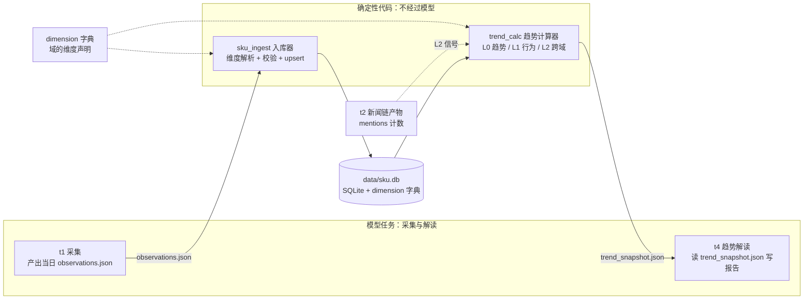
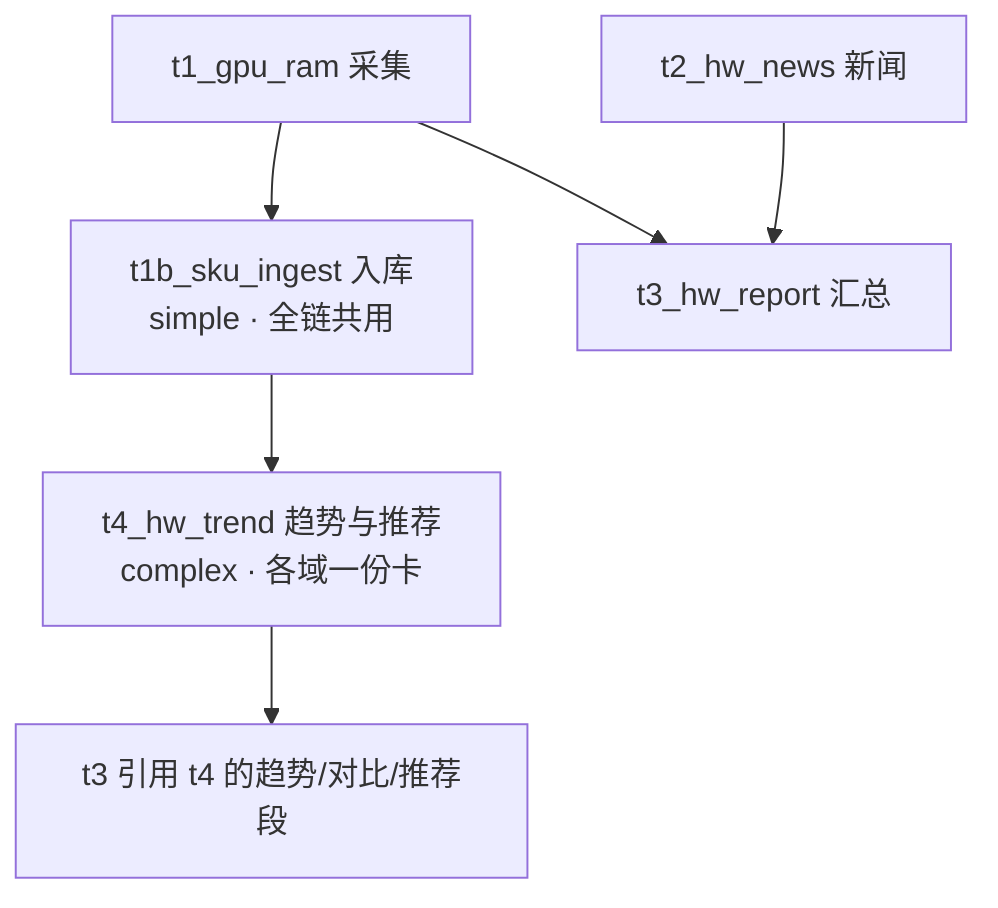

# 设计文档：通用实体时序观测库与趋势分析（sku.db）

> **存档版本 v3**（2026-10-10 指标层并入 + 人性弱点视角）· 本文件是历史存档，不再更新。
> 当前评审稿见 `sku-timeseries-db-v3.1.md`；版本总索引见 `sku-timeseries-db.md`。

---

> 状态：**待评审（v3，指标层并入）** · 起草 2026-10-10
> 适用范围：orchestrator 全部调研链（硬件 / 房产 / 未来的任意域）
> 评审方式：文末「开放问题清单」需拍板，其余为实现细节可后续调整。

**v3 修订记录**（评审意见：发掘新价值 + 事前决策价值修正）：
- 新增 **§8 指标层**：L0 基础趋势 / L1 行为指标（事前化）/ L2 跨域信号，
  全部通过「事前决策价值测试」（受众=待决策者、输出必挂可行动作）；
- §7 推荐结构**动作化**重写：每个结论必须带 `action` 字段；
- 指标准入原则升格为设计约束（见 §8.0）；
- 分期新增 P1.5（行为指标）；开放问题新增 Q10-Q12。

**v2 修订记录**（评审意见：模块化与抽象化，不许为单一域定制）：
- ~~序列 = (domain, canonical_name, channel)~~ → **序列 = 域声明的身份维度元组**；
  channel 从硬编码枚举降级为普通修饰维度；
- 新增**维度模型**（§4 D2）：身份维度 / 修饰维度 / 聚合粒度三层抽象，
  显卡的品牌型号与房产的小区楼层用同一套机制表达；
- 新增**控制变量对比**（contrast）作为趋势计算器的一等输出；
- 核心表结构域无关：域特有知识全部外置到 `dimension` 字典表。

---

## 1. 背景与目标

用户需求（2026-10-10 原话归纳）：

1. **SKU 级逐日记录**：如 RTX 5060 Ti 8G 每日低价入库（含店铺信息、优惠券情况），
   逐日累积观察变化趋势；
2. **价格趋势分析**：哪些 SKU 在快速下降、哪些在快速拉高、哪些趋平稳可以入手；
3. **综合推荐建议**：最近哪款涨得高、哪款性价比高、装机推荐哪款；
4. **跨域范式**：不止显卡——楼市某楼盘某户型的价格变化同样入库，
   随时间绘制趋势，判断「哪一个可以入手、房价是否企稳」；
5. **（v2）高复用性**：价格的影响维度——房产的楼层/楼栋、显卡的
   AIC 品牌/显存规格——必须用同一套机制建模；
6. **（v3）新价值而非省时间**：慢慢买/什么值得买/闲鱼已提供基础趋势，
   本框架要提供**单一平台给不出的视角**（跨域交叉、事前风险度量），
   且只做**对冲人性弱点的工具**，不做利用人性弱点的流量内容
   （方法论沉淀于 skill：value-lens）。

## 2. 现状诊断（为什么不能直接「把 CSV 存进库」）

拿 hardware_daily 的 t1_gpu_ram.csv 实测（2026-10-08 ~ 10-10 三天）：

| 日期 | 同一颗 RTX 5090 的「型号」写法 | 价格日期口径 |
|---|---|---|
| 10-08 | `GeForce RTX 5090(美行新卡最…)` | 2026-10-06 |
| 10-09 | `RTX 5090(国行整机参考)` | 2026-10-01 |
| 10-10 | `RTX 5090 (京东5090D 全新)` | 2026-10-03 |

三个致命问题：

- **实体命名漂移**：渠道/成色/AIC 品牌的后缀每天随机挂在型号字符串里，
  同一实体三天三个写法，跨日 join 不可能成立；
- **维度混杂**：单卡国行、整机参考、美行折算混在一列里，
  价格差出 2 倍（34999 vs 84899），纵向对比无意义；
- **环比是模型口算的**：`上期价格` 列大量「未查到」，涨跌幅随机缺失。

结论：**入库前必须先解决「序列身份」问题**。而身份问题的本质是
**维度问题**（§4 D2）。

另一个现状约束：executor 渲卡/产物全部走文件（artifacts/），
模型没有也不应有直接写 DB 的能力。**写库与算趋势都应是确定性代码，
模型只产数据与解读**。

## 3. 设计总览



分工铁律：**模型**检索、抄录、解读叙事；**确定性代码**做维度解析、
入库、全部指标计算。trend_snapshot.json 里每个数字可由 python_test
对 DB 重算复核。

## 4. 核心设计决策

### D1 数据库选型与位置：SQLite，`data/sku.db`

- 单机单写者（入库器），量级小（百实体 × 千日 = 十万行级）；
- 与 `state/state.db`（任务状态机）**物理分离**；
- 预留 WAL 模式（读并发）。

### D2 维度模型（v2 核心）：身份维度 / 修饰维度 / 聚合粒度

**三层抽象，对任何域成立**：

| 层 | 语义 | 决定什么 | 例子（硬件） | 例子（房产） |
|---|---|---|---|---|
| **身份维度** identity | 实体「是什么」 | 序列的唯一键 | `category=显卡, series=RTX 5060 Ti, spec=8GB` | `city=南京, estate=仁恒江湾城, layout=89㎡三房` |
| **修饰维度** attrs | 「哪个变体/哪笔报价」 | 观测行属性，可对比可聚合 | `vendor=七彩虹, channel=国行单卡` | `floor_band=中楼层, building=3栋` |
| **聚合粒度** series | 趋势线画到哪层 | 按 identity（默认）或 identity+某修饰维度切序列 | 型号市场价 / 七彩虹单品走势 | 小区户型行情 / 按楼层切片 |

- 「同品牌不同型号差异」→ 型号是身份维度，各画各线；
- 「同型号不同品牌差异」「同楼不同楼层价差」「同层跨小区价差」→
  都是 contrast（固定其余维度、变一个），计算器不感知域语义；
- 修饰维度可升格为身份维度（字典一改，观测数据按新元组重投影，
  attrs_json 原样保留，**数据永不搬迁**）。

### D3 实体解析：字典驱动 + 确定性规则，模型只给提示

1. 读该域 dimension 声明；2. 确定性归一化（硬件：剥渠道括号、`ti→Ti`、
`8G→8GB`；房产：小区名 `·` 统一、楼层归段）；3. 查注册表与别名表；
4. 模型的 `identity_hint` 仅作提示，入库器最终裁决；5. 未命中进
**隔离区**（宁缺毋滥，日报报数，定期收编）。

### D4 模型只产 JSON，入库是确定性管道

`artifacts/{date}/t1_sku_observations.json`（形状内联进卡）：

```json
[{
  "identity_hint": {"series": "RTX 5060 Ti", "spec": "8GB"},
  "attrs_hint": {"vendor": "七彩虹", "channel": "国行单卡"},
  "low_price": 2899.0, "raw_price": 3199.0, "price_date": "2026-10-10",
  "shop": {"name": "七彩虹京东自营旗舰店", "platform": "京东", "url": "…"},
  "coupons": [{"name": "满3000减200", "amount": 200, "threshold": 3000, "expire": "2026-10-15"}],
  "in_stock": true, "source_url": "…", "source_tier": "B"
}]
```

房产同构：`identity_hint={"city":"南京","estate":"仁恒江湾城","layout":"89㎡三房"},
attrs_hint={"floor_band":"中楼层","building":"3栋"}`。hint 的 key 必须在
字典声明内（未声明 key 进隔离区）；行级校验坏行进隔离区并告警。

### D5 趋势与对比：确定性计算（详见 §8 指标层）

序列点 = 聚合规则（默认该切片当日所有观测的 `min(low_price)`，
可按域配 median）。快照附 mermaid 数据段，t4 逐字引用。

### D6 入库触发方式（推荐 B：独立 simple 任务）

| 方案 | 做法 | 判定 |
|---|---|---|
| A. run_daily hook | t1 DONE 后调脚本 | 污染通用驱动器 ❌ |
| **B. 独立 simple 任务** | `t1b_sku_ingest` 执行 `python -m tools.sku_ingest --date {date}`，验收 python_test 查行数 | 有状态/重试/验收 ✅ |
| C. verifier 触发 | 验收管线内嵌 | 语义污染 ❌ |

入库任务模板**全链共用一份**（`templates/sku_ingest.yaml`）。

### D7 幂等与重跑

- 入库唯一键 `(entity_id, obs_date, shop_platform, shop_name)`，
  重跑 upsert；
- 趋势快照纯函数式重算；
- 回填复用同一命令（见 §11）。

## 5. 数据模型（DDL，核心表域无关）

```sql
-- 维度字典：域的知识全部在这里，核心表不出现任何域特有列
CREATE TABLE dimension (
  domain     TEXT NOT NULL,
  kind       TEXT NOT NULL,      -- identity / attr / aggregate_rule / normalizer
  key        TEXT NOT NULL,
  value      TEXT,               -- 合法值枚举（attr 用；NULL=自由值）
  rule       TEXT,               -- 归一化规则（normalizer 用）
  PRIMARY KEY (domain, kind, key)
);
-- 示例：('hardware','identity','series',NULL,NULL)
--       ('hardware','attr','channel','["国行单卡","整机参考","美行折算","二手"]',NULL)
--       ('housing','attr','floor_band','["低楼层","中楼层","高楼层","顶楼"]',NULL)

-- 实体注册表：一行 = 一个被跟踪实体
CREATE TABLE entity (
  entity_id     INTEGER PRIMARY KEY,
  domain        TEXT NOT NULL,
  identity_json TEXT NOT NULL,   -- 键序=字典声明序
  display_name  TEXT NOT NULL,   -- 身份维度确定性拼接（展示用）
  aliases       TEXT,            -- JSON：别名（人工兜底）
  perf_anchor   REAL,            -- 可选价值锚点（性价比分母）
  active        INTEGER NOT NULL DEFAULT 1,
  created_at    TEXT, updated_at TEXT,
  UNIQUE(domain, identity_json)
);

-- 观测表：一行 = 某实体某价格日某店铺的一笔报价
CREATE TABLE observation (
  id           INTEGER PRIMARY KEY,
  entity_id    INTEGER NOT NULL REFERENCES entity(entity_id),
  obs_date     TEXT NOT NULL,    -- 价格日期（页面口径）
  collected_on TEXT NOT NULL,    -- 采集日
  low_price    REAL, raw_price   REAL,
  metric       TEXT NOT NULL DEFAULT 'price',   -- price / unit_price / rr_pct …
  price_unit   TEXT NOT NULL DEFAULT 'CNY',
  attrs_json   TEXT,             -- {"vendor":"七彩虹","channel":"国行单卡"}
  shop_name    TEXT, shop_platform TEXT, shop_url TEXT,
  coupons      TEXT, in_stock    INTEGER,
  source_url   TEXT, source_tier TEXT,
  raw_json     TEXT,             -- 整行快照（审计/重投影）
  created_at   TEXT,
  UNIQUE(entity_id, obs_date, shop_platform, shop_name)
);
CREATE INDEX idx_obs_entity_date ON observation(entity_id, obs_date);

-- 隔离区
CREATE TABLE observation_quarantine (
  id INTEGER PRIMARY KEY, collected_on TEXT, reason TEXT,
  raw_json TEXT, created_at TEXT
);
```

## 6. 任务编排变更（以 hardware_daily 为例，其余域同构）



- **t1（改）**：objective 增加副产物 observations.json；
- **t1b（新，simple，共用模板）**：执行入库，验收 = python_test 查
  当日新增/更新行数 ≥10 且隔离区增量汇报；
- **t4（新，complex）**：读 trend_snapshot.json，产出 `hw_trend.md`
  （趋势榜 + 对比段 + mermaid ≥3 张）+ `hw_recommend.json`（§7）；
- **t3（改）**：引用 t4 产物，「综合推荐」逐字引用并附图。

验收门禁：t4 的 python_test 从 DB 重算抽样指标与快照一致（防模型改数）；
推荐入榜实体必须非 `insufficient_data`。

## 7. 推荐建议的结构（hw_recommend.json，动作化）

**v3：每个结论必须带 `action` 字段**——没有对应动作的结论不进推荐
（value-lens 准入原则在输出层的体现）：

```json
{
  "date": "2026-10-10",
  "decisions": [
    {"entity": "RTX 5060 Ti 8GB", "signal": "stable_buy",
     "evidence": "vol_7=0.9%, 距30日低点+1.2%, stab_risk_median=4%",
     "action": "act_now", "note": "可入手；历史相似处境30天中位回撤仅4%"},
    {"entity": "RTX 5090D 32GB", "signal": "fast_rise",
     "evidence": "slope_7=+1.8%/期, fomo_index=78",
     "action": "wait", "note": "情绪过热；等斜率走平或新品发布前6周"},
    {"entity": "南京·仁恒江湾城·89㎡三房", "signal": "distress_listing",
     "evidence": "挂牌价偏离同小区中位数-9%, 连续3日降幅>1%/日",
     "action": "probe_offer", "note": "疑似急售，可按25分位以下试探出价"}
  ],
  "notable_contrasts": [
    {"fixed": "RTX 5060 Ti 8GB", "vary": "vendor",
     "takeaway": "七彩虹比公版低3.3%，同保修口径下 action=选七彩虹"}],
  "no_advice": [{"entity": "…", "why": "insufficient_data(4期<60期门槛)"}]
}
```

`action` 枚举（域可扩展，但必须有）：`act_now / wait / probe_offer /
switch_to(附目标实体) / lower_offer(附分位目标)`。推荐**叙事**由模型写，
**入榜资格与 action 挂钩**由确定性规则决定。

## 8. 指标层（v3 新增：三级指标，全部事前化）

### 8.0 指标准入原则（设计约束）

> 每个指标落地时必须回答「**所以我现在该做什么**」；只对已完成交易者
> 有意义（事后懊悔确认）、或挂不上动作的，是情绪内容，**不进框架**。
> 受众永远是**待决策者**；人性弱点只**对冲**（发作时给冷静数据），
> 不**利用**（制造焦虑换流量）。方法论：skill `value-lens`。

### 8.1 L0 基础趋势（P1，纯库内计算）

| 指标 | 定义 | 门槛 |
|---|---|---|
| `d1_pct` / `slope_7` / `vol_7` | 环比；近7期最小二乘斜率(%/期)；波动率 | 覆盖≥5期 |
| `min_30` / `pct_from_low` | 近30期最低；现价距低点% | 覆盖≥20期 |
| `label` | fast_drop/drop/stable/rise/fast_rise/near_low | — |
| `contrast` | 控制变量对比（fixed×vary → 各组价格+spread_pct） | 每组≥5期 |

### 8.2 L1 行为指标（P1.5，纯库内计算，事前化）

| 指标 | 定义（事前视角） | 人性对冲 | 门槛 | 挂的动作 |
|---|---|---|---|---|
| `stab_risk` 背刺风险 | **若今日买入**，历史全部买入日 forward 回撤 `max(0,(p_t-min(p_t..t+30))/p_t)` 的中位数与 p75；进阶版按「相似处境」（价格分位×斜率标签）过滤 | 嗔（怕买贵） | ≥60期 | wait / act_now |
| `wait_value` 等待收益 | 历史上「再等90期」平均省的百分比 = E[p_t - p_(t+90)]/p_t | lust（新品冲动） | ≥120期 | wait |
| `anchor_check` 锚定检测 | 声称原价 raw_price 在序列历史的真实出现率 → `real/partial/fictional`；真实折扣率 = 1-low/raw | 痴（锚定） | ≥30期 | switch_to / 拒下单 |
| `sloth_tax` 懒人税 | 同实体同日跨 shop_platform 的 (max-min)/min | sloth（不比价） | 当日≥2平台 | switch_to(店铺) |
| `offer_percentile` 出价分位 | 给定目标价在近90期成交分布的分位（房产主用，通用计算） | envy（攀比锚错位） | ≥20期 | lower_offer(分位目标) |
| `perf_premium` 溢价税 | 现价/性能锚点 与该域「甜蜜点」实体的同比值之比 | gluttony/pride | perf_anchor 齐 | switch_to(甜蜜点) |
| `distress_signal` 急售指纹 | 单序列价偏离同 identity 中位数>X% 且连续降幅陡（缺挂牌时长，用降幅速度代理） | 痴（信息差） | ≥30期 | probe_offer |

### 8.3 L2 跨域信号（P2，需要库外数据 join）

| 指标 | 数据组合 | 人性对冲 | 挂的动作 |
|---|---|---|---|
| `fomo_index` 温度计 | slope_7 标准化 × 二手挂牌量变化（闲鱼轨） × 新闻提及密度（t2 产物按 display_name 计数）→ 0-100 | 贪（追涨冲动） | wait（>70 时强制提示） |
| `arb_window` 跨轨套利 | 国行 vs 美行折算价差 > 关税+运费阈值（channel 对比，附风险标注） | 贪（正确用法） | probe_offer |
| `stabilization` 企稳判据 | vol_30 收敛 × contrast spread 收敛 ×（有量数据时）成交平稳 | 嗔/痴（恐慌或观望过度） | act_now（房产出手窗口） |

**数据依赖声明**：fomo_index 需要 t2 新闻产物提供可计数的实体提及
（t4 计算时对 `t2_hw_news.md` 按 display_name 做文本匹配即可，不要求
新闻任务改结构，P2 再考虑结构化 mentions 字段）；stabilization 的
成交量依赖若楼市采集补不到，降级为纯价格收敛判据并如实标注。

### 8.4 sufficiency 分级（v3 细化）

| 指标层 | 最少覆盖期 | 不足时行为 |
|---|---|---|
| L0 趋势 | 5 期 | 标 `insufficient_data`，禁下趋势结论 |
| L1 stab_risk / wait_value | 60 / 120 期 | 显式标「样本不足，仅展示 L0」 |
| 其余 L1 / L2 | 20-30 期 | 同上分级 |

## 9. 数据质量防线

| 风险 | 防线 |
|---|---|
| 模型抄错价格 | 数值域检查（偏离近7期均值>50% → 隔离区+P2告警） |
| 维度伪装进型号串 / 模型发明维度 | 归一化剥离 + hint 键白名单 |
| 同日多店铺多价 | 全部入库，序列点=当日聚合 |
| 修饰维度取值漂移 | attr 枚举 + 归一化规则 |
| 序列断档 | sufficiency 分级禁言 |
| **指标被模型改写**（v3） | t4 验收 python_test 从 DB 重算抽样指标（含 1 个 L1）与快照一致 |

## 10. 楼市域接入（P2，通用性试金石）

不写楼市专用代码，只做：dimension 字典插行 + 两条链挂共用入库任务
（rr_top20：identity={city,estate}，metric 走 rr_pct/unit_price 双序列；
楼盘户型：identity={city,estate,layout}）。楼市特有视角全部由通用指标
覆盖：offer_percentile（出价分位）、distress_signal（急售捡漏）、
stabilization（企稳判据）。**若接入需要改核心表/计算器 = 抽象失败，
回本档修订**。

## 11. 历史回填

- 9-29 ~ 10-10 共 11 天 CSV 回填（预计映射率 60-70%，其余进隔离区），
  把 sufficiency 垫到 5 期以上让 L0 先跑起来；L1 需 60+ 期，
  靠后续自然累积（硬件域约 2 个月，或接入「慢慢买」历史页回填——
  见开放问题 Q10 附注）；
- 回填前 `--dry-run` 出「旧型号串 → identity」映射表人工确认。

## 12. 分期实施

| 期 | 内容 | 交付物 |
|---|---|---|
| **P0** | schema（含字典）+ 归一化器 + 入库器 + t1 模板改造 + 回填 | sku.db 开始累积 |
| **P1** | L0 趋势 + contrast + t4 任务 + 验收 + 报告改造 | 日报出现趋势榜/对比/图 |
| **P1.5** | L1 行为指标（stab_risk/anchor_check/sloth_tax/offer_percentile…） | 推荐 action 化 |
| **P2** | L2 跨域信号（fomo/arb/stabilization）+ 楼市域接入 | 跨域范式成立 |

## 13. 开放问题清单（需评审拍板）

| # | 问题 | 我的倾向 |
|---|---|---|
| Q1 | dimension 字典维护界面：改 DB vs yaml 为源（git 可评审） | yaml 为源、DB 为缓存 |
| Q2 | 隔离区收编：人工 vs 模型提案+人工确认 | 后者 |
| Q3 | 楼层粒度：分段入 attrs、精确层留 raw_json | 分段（段内差异走对比原文） |
| Q4 | perf_anchor 来源：人工表 vs 检索跑分 | 人工小表（20-30 实体），字段已预留 |
| Q5 | 趋势图粒度：榜单聚合图+top3 单品图 | 后者 |
| Q6 | 序列轴：页面 price_date vs 采集日 | price_date，缺日回落采集日并打标 |
| Q7 | 硬件首发注册表清单（~30） | 我出默认清单评审勾改 |
| Q8 | t4 频率：随链每日 vs 低频 | 每日但只输出增量段 |
| Q9 | attrs 合法值初版枚举 | 随 P0 出默认，评审勾改 |
| Q10 | stab_risk「相似处境」定义：全史中位数 vs 特征匹配（价格分位×斜率标签） | 先全史中位数（P1.5），特征匹配 P2 再加；附：L1 的 60 期门槛可考虑爬「慢慢买」历史页加速回填，但注意其口径进 attrs 标注 |
| Q11 | fomo_index 三因子权重 | 等权起步，积累数据后回归调参（权重进 dimension 字典可配） |
| Q12 | L1 门槛不足时的降级展示：隐藏 vs 显示「样本不足」占位 | 显示占位（诚实优于留白，且提示回填价值） |

---

附：本设计不改变「模型-验收-确定性代码」权责边界；确定性组件放
`orchestrator/tools/`。通用性验收标准 = §10：**楼市接入零核心代码改动**。
指标层验收标准 = §8.0：**每个指标挂得上动作，否则不进框架**。
